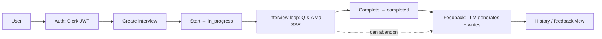
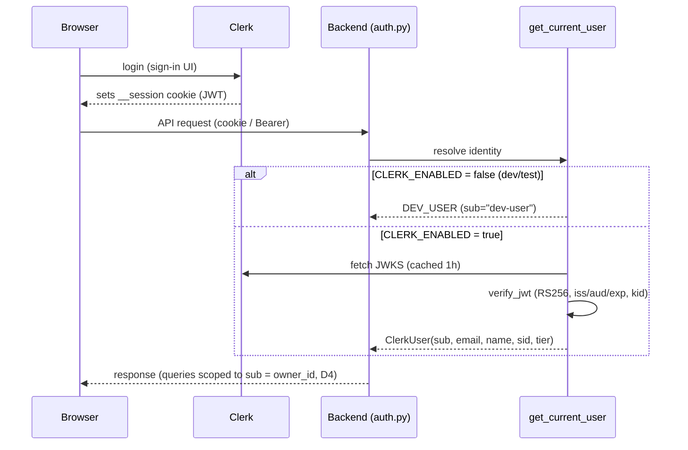
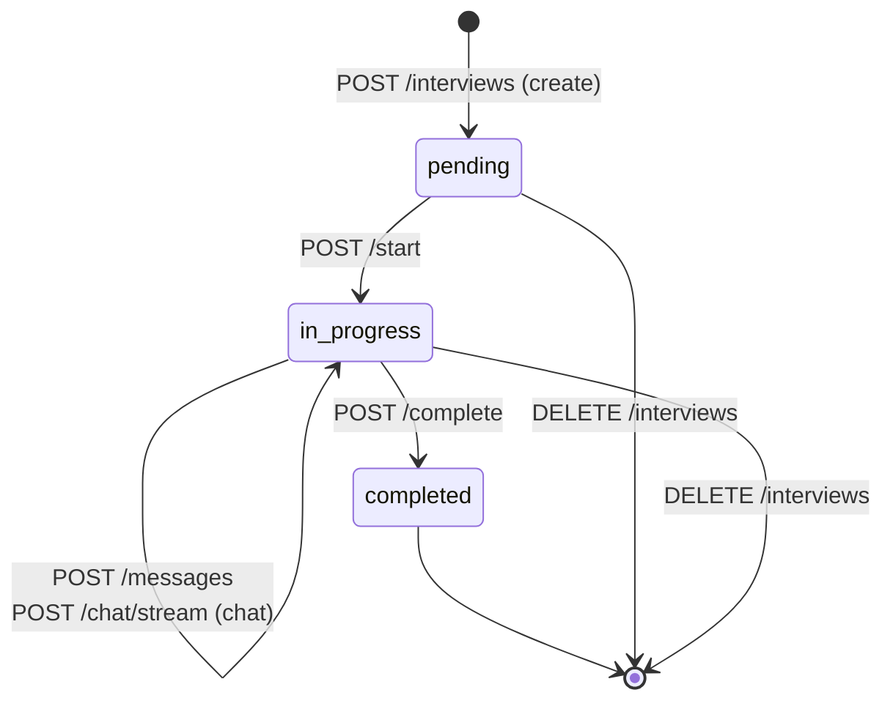
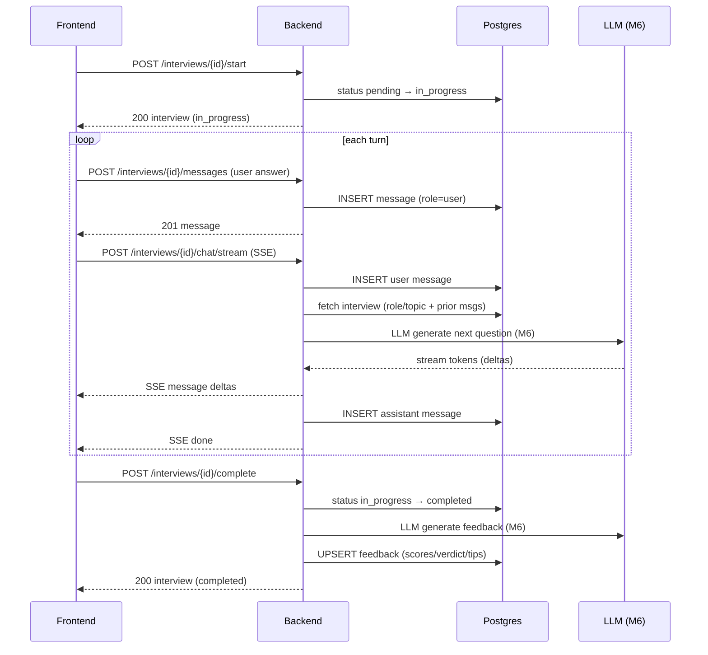
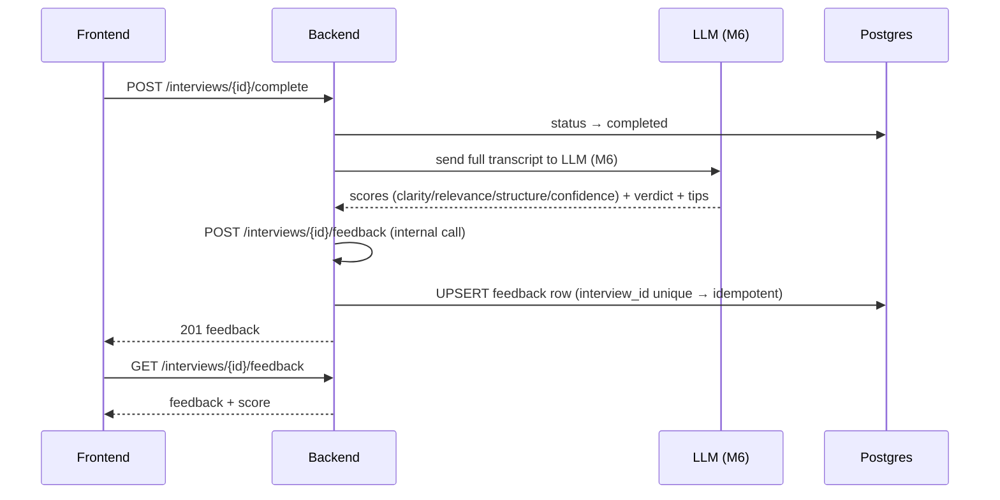
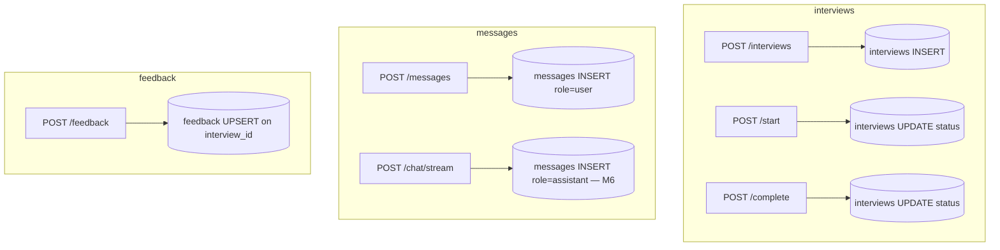

# APPFLOW — Application Flow

**Detailed application flow for maxterview.** Maps the PRD's user journey onto the implemented API,
data model, and auth. Read alongside `PRD.md` (product), `PLAN.md` (tech/decisions), `MONETIZATION.md` (billing).
**Status:** reflects the currently implemented backend (M1–M5). LLM parts marked **M6** are designed-not-built.

---

## 0. Flow at a glance



---

## 1. Auth flow (implemented, M4)



- **Cookie is primary** (`__session`); `Authorization: Bearer` accepted for API clients/tests.
- Every handler depends on `get_current_user` → a `ClerkUser` with `.sub` = the `owner_id` used to scope all DB queries (D4).
- Dev/test bypass uses `DEV_USER` (D2) — no Clerk needed.

---

## 2. Interview lifecycle (implemented in API)



### Status transitions & rules
| Status | Entered by | Allowed next |
|---|---|---|
| `pending` | `POST /interviews` | `start` (or `delete`) |
| `in_progress` | `POST /interviews/{id}/start` | messages, chat/stream, `complete`, `delete` |
| `completed` | `POST /interviews/{id}/complete` | (read-only, `delete`) |

**Guards (all owner-scoped, D4):**
- `start` requires `pending` → else 409; foreign → 404.
- `complete` requires `in_progress` → else 409; foreign → 404.
- `POST /messages` and `POST /chat/stream` require `in_progress` → else 409; foreign → 404.
- **Messages become read-only after `completed`** (no new turns).

---

## 3. Endpoint → flow mapping

| PRD story | HTTP | Purpose |
|---|---|---|
| US1 | `POST /interviews` | Create interview (role required, topic optional) → `pending` |
| US5 | `GET /interviews` | List own interviews (newest first), each with optional avg `score` + `verdict` (LEFT JOIN feedback) |
| US1/5 | `GET /interviews/{id}` | Get one own interview |
| — | `DELETE /interviews/{id}` | Delete own interview |
| US2 | `POST /interviews/{id}/start` | `pending` → `in_progress` |
| US3 | `POST /interviews/{id}/messages` | Add a user message (only while `in_progress`) |
| US2/3 | `POST /interviews/{id}/chat/stream` | **SSE** — stream assistant turn (M6 replaces stub) |
| US4 | `POST /interviews/{id}/complete` | `in_progress` → `completed` |
| US4 | `POST /interviews/{id}/feedback` | **M6** writes feedback (idempotent UPSERT) |
| US6 | `GET /interviews/{id}/messages` | View past conversation |
| US4/5 | `GET /interviews/{id}/feedback` | View feedback + score |

---

## 4. The interview loop (the core flow)


> **M6 note (2026-08-19):** the loop now streams **delta tokens** (`event: message` per delta, then `event: done`), persists **both** the user and assistant turns, and `complete` **auto-generates + writes feedback**. In dev without an LLM (`LLM_BASE_URL` empty), `app/llm.py` runs in deterministic **STUB_MODE** so the flow works model-free.
---

## 5. Feedback & scoring flow (M6)


- **Soft ordering (product decision 2026-08-19):** M6 writes feedback **before** or independently of
  completion; `complete` does **not** require feedback. The M6 flow generates-then persists feedback.
- `POST /interviews/{id}/feedback` is an **UPSERT** on `interview_id` (UNIQUE) — safe to retry.

---

## 6. Data flow (write paths)


- All writes are **owner-scoped** (`WHERE owner_id = $sub` or FK via an owned interview).
- `db.py` helpers: `fetch` / `fetchrow` / `execute` over a lazy asyncpg pool.

---

## 7. Error handling summary

| Condition | Status |
|---|---|
| Missing/invalid token | 401 |
| Foreign interview (not owned) | 404 |
| Wrong status for action (`start` not pending, `complete` not in_progress, message/chat not in_progress) | 409 |
| Message validation (empty / >10k chars) | 422 |
| Feedback missing | 404 |

---

## 8. Auth config: what's live vs pending

| Piece | State |
|---|---|
| `get_current_user` (dev fallback + Clerk path) | ✅ implemented |
| `verify_jwt` (RS256, kid, iss/aud/exp) | ✅ implemented (tested vs self-generated keys) |
| `_fetch_jwks` (cached) | ✅ implemented |
| Real Clerk instance verification | ⏳ pending a real sign-in token (CLERK_ENABLED still false in dev) |
| Frontend ClerkProvider | ✅ wired (`known-polecat-16`) |

---

## 9. Golden path (end-to-end happy flow)

Numbered walkthrough of the primary experience, with expected responses (dev/test user = `dev-user`).

1. **Create** — `POST /interviews` `{role, topic?}` → `201` interview, `status: "pending"`.
2. **List** — `GET /interviews` → array including the new interview.
3. **Start** — `POST /interviews/{id}/start` → `200`, `status: "in_progress"`.
4. **Answer** — `POST /interviews/{id}/messages` `{content}` → `201` message (role `user`). *(Any attempt before `start` → `409`.)*
5. **AI turn** — `POST /interviews/{id}/chat/stream` `{interview_id, content}` → `200` SSE; consume events (M6 streams real assistant reply).
6. **Loop** — repeat steps 4–5 until the user ends.
7. **Complete** — `POST /interviews/{id}/complete` → `200`, `status: "completed"`. *(Requires `in_progress`; else `409`.)*
8. **Feedback** — (M6) backend generates + writes via `POST /interviews/{id}/feedback` → `201`.
9. **Review** — `GET /interviews/{id}/feedback` → `200` feedback + score; `GET /interviews/{id}/messages` → full transcript.
10. **History** — `GET /interviews` shows the completed interview (newest first).

---

## 10. SSE wire contract (`POST /interviews/{id}/chat/stream`)

The endpoint returns `text/event-stream`. This is the **consumer contract** the frontend (M8) must parse.

**Current stub events:**

```
event: message
data: <text>

event: done
data: {}

```

**Event types:**
| Event | Payload | Meaning |
|---|---|---|
| `message` | `data: <string>` | A chunk/turn of the assistant reply (delta token or full turn). |
| `done` | `data: {}` | Stream finished; no further events. |

> **M6 note (2026-08-19):** the stream now emits **incremental `message` deltas** (word/token chunks),
> then a final `done`, and the assistant `messages` row is persisted server-side. Contract stable; a real
> model at M6+ supplies the actual deltas (dev STUB_MODE emits the echoed user reply tokenized).

---

## 11. Abandoned interviews & M10 hook

- **Abandoned `in_progress`:** if a user starts but never completes, the interview stays `in_progress`.
  It remains visible in history and can be `DELETE`d; there is no auto-expiry in MVP. (Reads stay fully
  available — consistent with the MONETIZATION "never hide existing data" rule.)
- **M10 quota hook:** the daily interview cap (MONETIZATION §3) will be enforced **on `POST /interviews`
  (create)** via a conditional INSERT (atomic). `tier` is already present on the `ClerkUser` dependency
  in every handler; the gate is stubbed until M10.
