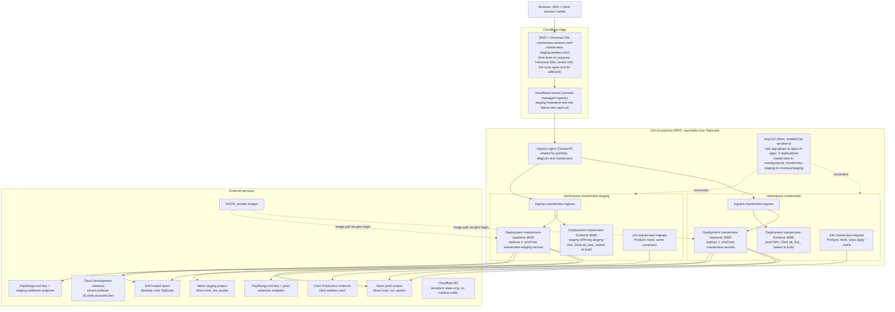
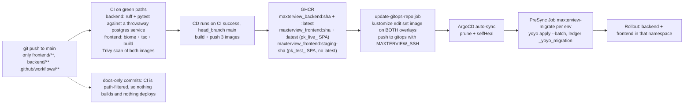
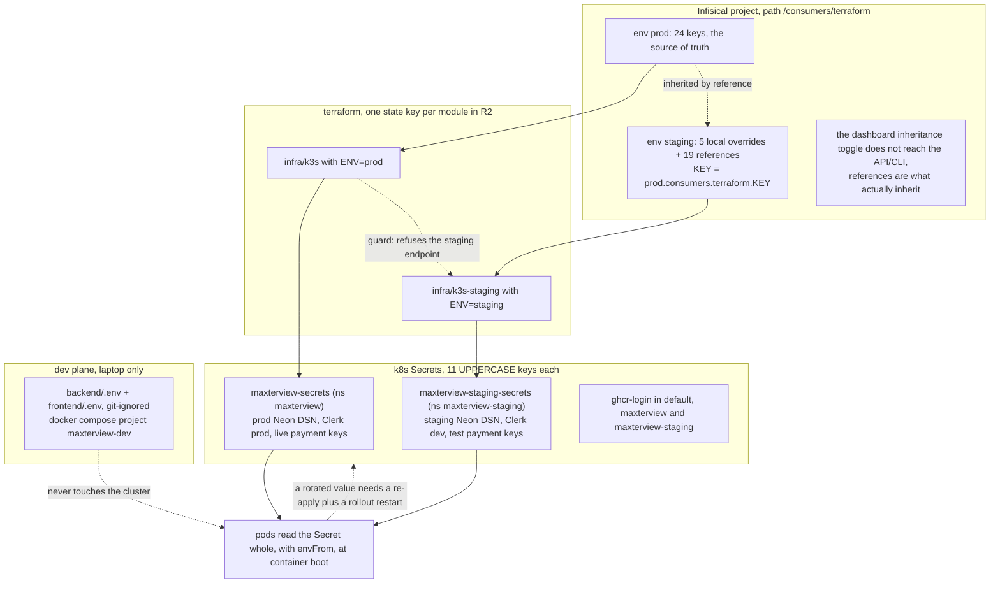

# Infrastructure Diagram

How maxterview is wired: what serves traffic, how a commit reaches both environments, and where each
environment's config actually comes from. Shapes and counts verified 2026-09-17 (staging went live).
Update this file when the shape changes, not when a value changes.

## 1. Runtime topology

Share these and you give the two environments a common failure mode: the cluster and node, ingress-nginx,
the tunnel, the LLM endpoint and the Neon org quota. The namespaces, secrets, database projects, Clerk
instance and payment mode are separate.

## 2. Deploy pipeline

One push to main moves prod and staging together, on the same SHA; there is no promotion step between them.
Staging is the rehearsal for the path, not a gate in front of it.

## 3. Config plane

The staging overrides are exactly five keys: the Neon DSN, the Clerk domain and JWKS, the payment key and
its webhook secret. Everything else in that environment is a reference to prod, which is why a key added to
prod does not appear in staging until the reference set is regenerated. Both root modules refuse the other
environment's Neon endpoint at plan time, so neither a typo nor a stale inherited value can point one
environment at the other's database.

## Not owned by terraform

These exist and are wired, but no apply creates or repairs them:

| Thing | Owner |
| --- | --- |
| Neon prod and staging projects | created in the Neon console, `destroy MOD=k3s-staging` leaves them |
| Cloudflare tunnel hostname rules | remote-managed tunnel config, never modelled in terraform |
| `staging` and `prod` Infisical environments | dashboard (the CLI cannot create environments) |
| ArgoCD Applications | `apps-of-apps/*.yaml` in the gitops repo, applied by the root app |
| Cluster-level objects (argocd, ingress-nginx, ns `maxterview`) | `infra/k3s`, never the staging module |
