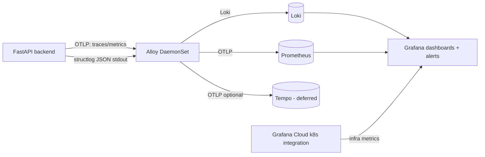

# OBSERVABILITY — maxterview

Observability plan for the MVP. **Docs-first milestone (M13)**: this file captures the design and
current state; implementation follows in a later code pass. Companion to `PLAN.md`, `SECURITY.md`,
and `README.md`.

> **Decided 2026-08-23:** Grafana-focused stack only (Loki + Prometheus + Grafana Cloud) — no Sentry.
> For a personal MVP the two overlap on error logging; a single Grafana vendor keeps one auth, one
> data plane, and leans on the structlog JSON logs we already plan. Sentry-style exception grouping
> can be revisited later if error triage at scale ever demands it — not now.

---

## Current state (verified 2026-08-23)

| Area | Status |
|---|---|
| Structured logging | ⚠️ **none wired** — `structlog` is a declared dependency (`pyproject.toml`) but **imported nowhere**; the app uses default/unstructured logging |
| Request logging | ⚠️ FastAPI default access logs only; no JSON, no per-request context |
| Error tracking / APM | ❌ none (no Sentry, no error-log queries) |
| Metrics | ❌ none (no Prometheus metrics endpoint) |
| Log aggregation / dashboards | ❌ none (no Loki/Grafana) |
| Health/readiness | ✅ `/health` (liveness only; no readiness/deep-health) |

**Conclusion:** observability is effectively absent. Everything below is a documented plan.

---

## Design (Grafana-focused) — 6 parts: logging, pipelines, metrics, probes, alerts, secrets

### 1. Logging — foundation (structlog JSON)

Use the already-declared `structlog` dependency. Output shape:
- **Production:** JSON (`structlog.processors.JSONRenderer`) — machine-parseable for Loki ingestion.
- **Development:** human-readable colored key/value output.

Wiring intent (future code pass):
- Configure `structlog` once at app startup (bind `app` name, env, request id).
- Add a FastAPI middleware/`logging` integration so every request emits one structured access log:
  `method`, `path`, `status`, `duration_ms`, `user` (`sub`), `interview_id` where present.
- Log LLM calls (model, tokens, latency) and feedback generation at info/debug.
- **Never log secrets:** no `DATABASE_URL`, `LLM_API_KEY`, Clerk tokens, or message bodies that could
  contain them. Log user message **lengths/ids**, not content, at debug-only if at all.

### 2. Log aggregation + metrics — Grafana Cloud (Loki + Prometheus + Grafana)

Single-vendor observability layer:
- **Loki** ingests the JSON structlog output. In the k3s cluster, scrape/forward via a log agent
  (Grafana **Alloy** or **promtail**) that ships pod stdout to Loki; label by `app`, `pod`, `env`.
- **Prometheus** (or Grafana Cloud's managed metrics) scrapes a backend metrics endpoint
  (`/metrics`) plus the node/pod targets. Add the FastAPI metrics endpoint in a code pass
  (`prometheus-client` fastapi instrumentation). Grafana Cloud also offers an agent that can scrape
  and remote-write.
- **Grafana dashboards:** request rate / latency / error rate over time, panel filters by
  `status`/`user`/`role`. Alerts on e.g. `status>=500` or error-rate thresholds — driven **from Loki
  queries** so we do not need a separate APM for error visibility.
- Logs and metrics share the same structlog fields (`duration_ms`, `status`, `user`), so a metric
  trace links back to the raw JSON log line in Loki.

> **Error tracking without Sentry:** errors surface as `status>=500` log lines in Loki. Query
> `{app="backend"} |= "error"` for triage; alert on rate. This covers MVP needs without a second
> vendor. Defer Sentry unless exception grouping/source-maps become a bottleneck.

### 3. Concrete metrics + `/metrics` endpoint (Gap A)

Add a FastAPI metrics endpoint (`/metrics`, OpenMetrics format via `prometheus-client` or the OpenTelemetry
Python SDK prometheus exporter) exposing counters/histograms. Instrument in the same request middleware, so
every signal carries the same labels (`method`, `path`, `status`, `user`).

**Metric set (MVP):**

| Metric | Kind | Meaning |
|---|---|---|
| `http_requests_total` | Counter | count, labeled by `method/path/status` |
| `http_request_duration_seconds` | Histogram | latency buckets (e.g. `status` label) |
| `llm_call_duration_seconds` / `llm_call_tokens_total` | Histogram/Counter | LLM latency + input/output tokens |
| `feedback_generation_duration_seconds` | Histogram | auto-feedback latency |
| `db_query_duration_seconds` | Histogram | asyncpg query latency (if instrumenting db.py) |
| `interviews_created_total` / `interviews_completed_total` | Counter | product counters |

**Transport:** OTLP for traces/metrics (see Rollout), and/or Prometheus scrape of `/metrics`. For Grafana Cloud
managed metrics, use the OTLP endpoint or remote-write from the agent.

### 4. Probes + infrastructure metrics (Gap B)

- **Probes:** today only liveness `/health` exists. Add **readiness** (reports ready only when the
  Postgres pool is initialized) and a **startup probe**; then the gitops `apps/maxterview` deployments can
  use `httpGet` (unlike the diagram apps' `tcpSocket` trade-off).
- **Infra dashboards:** enable the **Grafana Cloud Kubernetes integration** for out-of-the-box
  node/pod CPU, memory, network, and k8s-events dashboards. This observes the cluster, not just the app.

### 5. Alerts + retention / volume caps (Gap C)

- **Alert rules (MVP):**
  - `status>=500` rate over 5m > threshold (from Loki logs).
  - `http_request_duration_seconds` p95 > target (e.g. 5s) over 5m.
  - `feature`/`feedback_generation` error count > 0 in 5m.
  - Pod not ready for > N minutes (from k8s integration).
- **Contact points:** email and/or Slack/Telegram/`webhook` in Grafana; route by severity. Wire through
  the Grafana Cloud UI or `alertmanager` config.
- **Retention / volume caps (free-tier):** Grafana Cloud free tier limits log retention + ingest volume;
  verbose structlog + k8s probe/`/health` spam can blow the cap fast. Plan **log shaping**: drop or
  de-dup `GET /health`, readiness probes, and repeated `404` noise; use `level` thresholds and Loki
  retention/ingest limits. Budget dashboard shows usage.

### 6. Secrets / credentials for Grafana Cloud (Gap D)

- The Grafana Cloud **OTLP endpoint**, **Loki push URL**, **cloud instance ID**, and **API token(s)** are
  credentials. They must reach the app/Alloy **without being committed** — supply via a k8s `Secret`,
  created by the Terraform installer from Infisical (same pattern as `maxterview-secrets`/`ghcr-login`).
- Alloy reads the token via `envFrom.secretRef`; the backend reads `OTEL_EXPORTER_OTLP_ENDPOINT` and
  any needed token from the same secret if it pushes directly.
- **No token in client code or committed manifests.**

> **Frontend observability (Grafana Faro / RUM) is deferred — keep server-side-only for MVP** (decision,
> Gap D). Revisit web-vitals / client error reporting in a later pass if needed.
---

## Rollout order

1. **structlog JSON logging (foundation)** — cheap, unblocks everything (Design §1).
2. **Probes** — add readiness + startup probes; use `httpGet` in the gitops deployments (Design §4).
3. **Grafana Cloud connect** — provision the tenant + secret; deploy **Alloy** as a k8s DaemonSet
   (OTLP forward + stdout→Loki); wire the backend OTel/OTLP exporter + `/metrics` (Design §2-3).
4. **Dashboards + infra integration** — app request/latency/error panels + k8s resource dashboards (Design §4).
5. **Alerts + log shaping** — alert rules + contact points; enforce free-tier retention/volume caps (Design §5).

---

## Out of scope (deliberately deferred — hobby, app-scoped)

These are real observability opportunities but are **not** worth the complexity for a personal,
single-service app. They are recorded so the decision is explicit, not accidental. Revisit if the app
grows to real traffic or multiple services.

- **Edge / ingress observability** — nginx-ingress + Cloudflare Tunnel + Cloudflare edge (WAF/4xx/5xx)
  dashboards. The app is reached through `Cloudflare → nginx → pod`; observing only the pod is fine at
  this scale. Site-down is noticed in Cloudflare's built-in analytics long before we need dedicated edge
  dashboards.
- **Request-id / trace correlation across layers** — the app is effectively a single service (one
  backend, one DB, one LLM), so multi-service trace/correlation plumbing has little payoff until that
  changes.
- **Synthetic / uptime probes** — a Grafana Cloud synthetic check on `/health` is cheap but optional
  for a personal app; drop if you rely on Cloudflare's uptime/health checks instead.
- **Dashboards/alerts as code (GitOps drift-fighting)** — hand-built Grafana dashboards are fine for
  personal use; converting to provisioning-as-code is cosmetic value, not a risk, until the k3s repo's
  everything-as-git philosophy demands it.

**Tempo (distributed tracing) remains deferred** (already noted) for the same scoped reason.
---

## Acceptance criteria (when implemented)

- [ ] Production logs are JSON; dev logs are human-readable.
- [ ] Every API request emits a structured access log (method/path/status/duration/user).
- [ ] No secrets appear in logs.
- [ ] Loki stores backend logs (via agent); labels `app`/`pod`/`env` populated.
- [ ] Grafana shows request rate/latency/error dashboards + an alert on `status>=500`.
- [ ] `/metrics` exposes the concrete metrics (Gap A) — HTTP/LLM/DB latency & counts.
- [ ] Backend has readiness + startup probes (Gap B); k8s infra dashboards enabled.
- [ ] Alert rules + contact points exist; log shaping keeps under free-tier retention (Gap C).
- [ ] Grafana Cloud credentials come only from a k8s Secret (no committed tokens) (Gap D).
- [ ] (Deferred) Prometheus `/metrics` if not via OTLP; frontend Faro RUM not in MVP.
