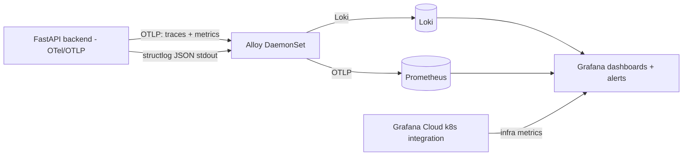

# OBSERVABILITY — maxterview

**Docs-first (M13).** Only the structlog calls have landed; `configure()` and the Grafana half have
not. Decisions: Grafana-only (**no Sentry** — for an MVP it overlaps with Loki error logs; revisit
only if exception triage at scale demands it).

## Current state

| Area                         | Status                                                                                                                                                                                                                            |
| ---------------------------- | --------------------------------------------------------------------------------------------------------------------------------------------------------------------------------------------------------------------------------- |
| Structured logging           | ⚠️ **half-wired** — `structlog` is used as `log` in `main.py`/`llm.py`/`byok.py`/`payments.py`, but `structlog.configure()` is never called: dev gets console output, prod does **not** get JSON, and there is no request context |
| Request logging              | ⚠️ FastAPI default access logs only; no JSON, no per-request context                                                                                                                                                              |
| Error tracking / APM         | ❌ none                                                                                                                                                                                                                           |
| Metrics                      | ❌ none                                                                                                                                                                                                                           |
| Log aggregation / dashboards | ❌ none                                                                                                                                                                                                                           |
| Health / readiness           | ⚠️ `/api/health` is shallow (no DB check), yet the Deployment probes it with `httpGet` for **both** liveness and readiness                                                                                                        |

## Design

- **Logging:** JSON in prod (`structlog.processors.JSONRenderer`), human-readable in dev. Configure once at startup (bind app name, env, request id) + a middleware emitting one structured access log per request: `method`, `path`, `status`, `duration_ms`, `user` (`sub`), `interview_id`. Log LLM calls (model, latency, tokens) and feedback generation; feedback failures carry a **content-free** `shape=` fingerprint (keys + scalar values/lengths), never the transcript — same rule as message bodies.
- **Never log secrets:** no `DATABASE_URL`, `LLM_API_KEY`, Clerk tokens, or message bodies.
- **Pipeline:** one **Alloy DaemonSet** (not a sidecar) ships pod stdout to **Loki**, labelled `app`/`pod`/`env`. Metrics go to Grafana Cloud Prometheus via **pure OTLP** from the OpenTelemetry SDK — no `/metrics` scrape endpoint.
- **Escape hatch:** the backend can push OTLP straight to Grafana Cloud's gateway with the same `OTEL_EXPORTER_OTLP_*` env, no Alloy and no cluster manifest — same exporter code, minus pod/node metadata.
- **Error tracking without Sentry:** `status>=500` log lines in Loki, alerted on rate.
- **Metrics:** `http_requests_total`, `http_request_duration_seconds`, `llm_call_duration_seconds`/`llm_call_tokens_total`, `feedback_generation_duration_seconds`, `db_query_duration_seconds`, `interviews_created_total`/`interviews_completed_total` — all labelled in the same request middleware.
- **Alerts:** 500-rate > threshold (from Loki), p95 latency > target, feedback errors > 0, pod not ready > N min. **Log shaping** matters on the free tier: drop `GET /api/health` and probe spam.
- **Secrets:** the OTLP endpoint, Loki push URL, instance ID and API token are credentials — a k8s `Secret` created by Terraform from Infisical, same pattern as `maxterview-secrets`. Never committed.
- **Deferred:** frontend RUM (Faro), Tempo traces, edge/ingress observability, uptime probes, dashboards-as-code — all recorded as deliberate deferrals for a single-service hobby app.

## Rollout order

M13 is two halves: app-local work is compose-verifiable today; the cluster half needs the gitops
**`infra/`** layer (Alloy DaemonSet + a Terraform-created `grafana-cloud` Secret), which is shared
plumbing and does not depend on `apps/maxterview`.

1. **structlog `configure()`** — JSON renderer in prod + request context. Cheap, unblocks everything. _App-local._
2. **Deepen readiness** with a DB check. _No longer waits on gitops._
3. **Grafana Cloud connect** — tenant + secret + Alloy DaemonSet; wire the OTLP exporter. Exporter and dev verification are _app-local_ (direct OTLP is the escape hatch); DaemonSet + secret _need `gitops/infra/`_.
4. **Dashboards** — request/latency/error panels + the k8s integration.
5. **Alerts + log shaping** — rules and contact points; enforce free-tier retention caps.

## Acceptance criteria

- [ ] Prod logs are JSON; dev logs are human-readable.
- [ ] Every API request emits a structured access log (method/path/status/duration/user).
- [ ] No secrets appear in logs.
- [ ] Loki stores backend logs (via agent); labels `app`/`pod`/`env` populated.
- [ ] Grafana shows request rate/latency/error dashboards + an alert on `status>=500`.
- [ ] Metrics reach Grafana Cloud Prometheus via **pure OTLP** (no `/metrics` scrape endpoint).
- [ ] Backend has readiness + startup probes; k8s infra dashboards enabled.
- [ ] Alert rules + contact points exist; log shaping keeps under free-tier retention.
- [ ] Grafana Cloud credentials come only from a k8s Secret (no committed tokens).
