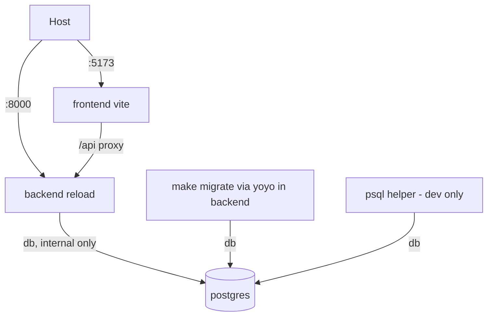
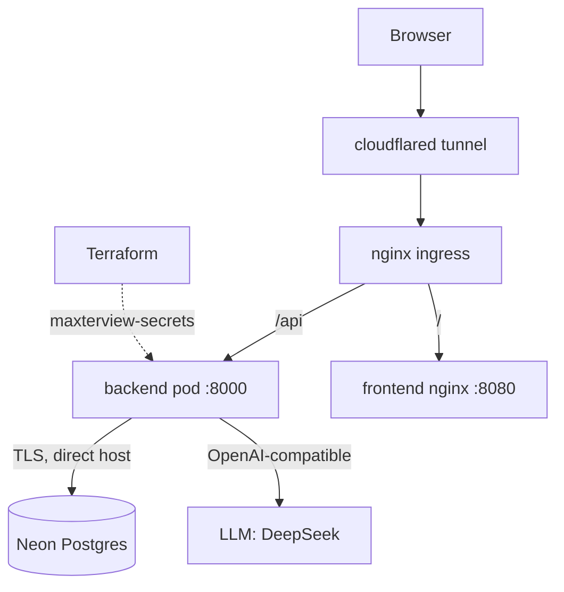

# PLAN — maxterview

 

**AI mock-interview coach** — practice interviews, LLM-generated questions/feedback/scoring, progress tracking. **MVP is text-only; voice is a later phase.**
Stack: FastAPI + React/TS + Postgres. Dev: Docker Compose (3-file split).

> **How to use this file** — the _stable contract_: reload at session start for decisions,
> guardrails, milestone status. Transient build state lives in session memory.
> **Scope:** this file = technical decisions + milestone status. The product as-built is documented in `README.md` (architecture, flow, endpoints, status); **billing spec** in `MONETIZATION.md`.
> **Docs hygiene (context = scarce):** one source of truth per topic — reference-only detail lives in its
> owning file (this file = decisions/status, MONETIZATION = billing, OBSERVABILITY = ops), never restated
> elsewhere. Decisions/status here are compact tables, not prose.
> When a milestone ships, **delete** the section that predicted it (don't add a “shipped” note beside it). Docs-first-but-not-built files are debt: prune them once their code lands.
> Before each session, `ls *.md` and drop anything whose header still claims an earlier milestone.
> Last cleanup: 2026-08-25 (APPFLOW + SECURITY folded into §7) → 2026-09-06: removed `PRD.md` (stale vs shipped billing; product framing kept in README).
>
> **Change policy:** edit only when a decision, milestone, or guardrail changes. `Last updated: 2026-09-12`

## 1. Decisions (D1–D13) — read first

| #   | Decision                                                                                                                                                                                                                                        | Rationale                                                                                                                                                                                                                                                                                                                                                                           |
| --- | ----------------------------------------------------------------------------------------------------------------------------------------------------------------------------------------------------------------------------------------------- | ----------------------------------------------------------------------------------------------------------------------------------------------------------------------------------------------------------------------------------------------------------------------------------------------------------------------------------------------------------------------------------- |
| D1  | `python:3.13-slim` in containers only; host Python irrelevant                                                                                                                                                                                   | Reproducible env; 3.13 mature (EOL 2029-10); 3.14 stable — valid upgrade path                                                                                                                                                                                                                                                                                                       |
| D2  | Clerk fallback (`CLERK_ENABLED=false`) only in `development`/`test`; else refuse to boot                                                                                                                                                        | No silent unauthenticated prod; tests boot without Clerk                                                                                                                                                                                                                                                                                                                            |
| D3  | Migrations via `make migrate` = `yoyo apply` (backend container, `yoyo-migrations` CLI); `.sql` files **whose entire body is the "up" step**, with a **separate `<name>.rollback.sql`** for rollback; tracks applied state in `_yoyo_migration` | **Correction (2026-08-16):** yoyo does **NOT** use in-file `-- migrate:up/-- migrate:down` markers — it treats the whole `.sql` as up and reads rollback from a separate `.rollback.sql`. An in-file `-- migrate:down` block gets executed as UP (created-and-dropped the tables). Lightweight Python analogue of node-pg-migrate (diagram_website reference); per-version tracking |
| D4  | Domain owned by Clerk `sub`; every query scoped                                                                                                                                                                                                 | Auth is load-bearing                                                                                                                                                                                                                                                                                                                                                                |
| D5  | `DATABASE_URL` derived, never literal: dev composes it from `POSTGRES_*`; prod injects an external secret (Neon, direct host). Never committed.                                                                                                 | Single derivation per environment; prod DB is external (Neon) so it cannot be composed                                                                                                                                                                                                                                                                                              |
| D6  | **uv** + `pyproject.toml` + committed `uv.lock`; `uv sync --frozen` in CI/Dockerfile                                                                                                                                                            | 2026 standard; universal lockfile                                                                                                                                                                                                                                                                                                                                                   |
| D7  | LLM = OpenAI-compatible client via env (`LLM_BASE_URL`/`LLM_API_KEY`/`LLM_MODEL`): **local model on dev, DeepSeek on prod**; stub for tests                                                                                                     | One interface, no vendor lock; DeepSeek is OpenAI-compatible                                                                                                                                                                                                                                                                                                                        |
| D8  | Frontend React + TS + Vite + **shadcn/ui** + **react-router** (SPA, deep-linkable `/interviews/:id`); backend structlog                                                                                                                         | User choices; TS matches API schemas                                                                                                                                                                                                                                                                                                                                                |
| D9  | **Monolithic backend**: routes + validation + handlers inline in `app/main.py` (mirrors `diagram_website`'s `server.ts`); **raw SQL via asyncpg**, single `app/db.py` (lazy pool)                                                               | MVP simplicity; no ORM, no premature layering; matches an existing, proven codebase shape                                                                                                                                                                                                                                                                                           |
| D10 | Monetization: two-tier free/premium (+ developer-only) subscriptions. Spec: `MONETIZATION.md`.                                                                                                                                                  | Retrofit gating later is costly; simplest model for an AI-coach SaaS                                                                                                                                                                                                                                                                                                                |
| D11 | **Environments ↔ Neon:** durable environments = **separate Neon projects** (`maxterview-prod`, `maxterview-staging`); **branches are disposable-only** (PR/preview, migration rehearsal, PITR) and live inside the **staging** project, never prod. `dev` + CI keep the local container Postgres. Staging is architected-for, not provisioned, until GitOps exists; prod resources currently sit in namespace `default` (like diagram/portfolio), so staging **must** get its own namespace — same-name `maxterview-secrets`/Deployment/Service would collide. | Free-plan quotas are **per project** (0.5 GB + 100 CU-h each, 100 projects). Sharing one project across two envs lets a busy staging starve prod's compute — every branch gets its own endpoint charged to the parent project. Durable envs also need separate role sets + history windows. Neon's own "staging as a branch" guidance assumes paid-tier quota headroom. `dev` stays local: hermetic, offline, no CU burn for hundreds of test runs |
| D12 | **DDL = separate credential + separate actor:** migrations on deployed envs run from an **in-cluster Job** (Argo CD PreSync) in the target namespace via `MIGRATE_DATABASE_URL` (migrator role, DDL); the app runs a least-privilege role (DML only) via `DATABASE_URL`. Never from CI, never from a laptop. Split **decided now, implemented at hardening** — prod v1 launches on the owner DSN. Unset `MIGRATE_DATABASE_URL` falls back to `DATABASE_URL` (dev compose). | A leaked app DSN must not be able to `DROP`; the prod DSN must not be copied into GitHub Actions; yoyo needs DDL, so it cannot keep sharing the app credential once roles exist. Reserving the var now avoids re-plumbing compose/CI/k8s later — retrofit costs more than creation |
| D13 | **Staging & promotion at solo scale:** one cluster, two namespaces (`maxterview`, `maxterview-staging`) rendered from `gitops` kustomize **base + overlays** (D11 = one Neon project per durable env). Promotion: **staging auto-bumps on green `main`, prod only via a manual `chore(gitops): deploy maxterview images <sha>` commit — the existing bump *is* the approval gate** (ADR 0002's human-gate philosophy). Parity is deliberately asymmetric: dev stays laptop-shaped, **staging is the env-truth target**. Identity/payments: staging = Clerk *development* instance + Stripe **test** mode; prod = real instances. | Staging buys exactly three things here — migration rehearsal on prod-shaped data, a real promotion gate, a safe load-test target (M18). The ritual is the point, not the users. Cost: one Neon project + one namespace + one overlay dir on a node already running; multi-cluster, canary analysis and paging buy a single owner nothing. Reusing the manual image bump adds zero machinery |
| D14 | **Frontend build config:** the SPA's Clerk publishable key is a **committed build default in `frontend/.env.production`** — public by design (a pk is only `pk_live_`/`pk_test_` + base64 of the Frontend API host, and it ships inside `dist/assets/*.js`). The Dockerfile needs no `ARG`: Vite reads the committed file. It must name the **same instance** as the backend's `CLERK_DOMAIN`/`CLERK_JWKS_URL` — the SPA authenticates against the instance whose JWKS the backend trusts. | Vite **inlines** `VITE_*` at build time, so this value can never come from the cluster Secret at runtime: some delivery path must exist. Committing it leaks nothing and costs zero credentials/settings. Rejected: GitHub repo variable (config outside the single store), Infisical machine identity + CI fetch (a credential + 3 repo settings for a public constant; a stale duplicate remains in Infisical because CLI 0.41.90 refuses the delete), nginx `config.js` runtime injection (9 files across 3 repos; its real payoff — one image per env — only arrives with staging). **Revisit trigger:** staging exists (per-env pk) or a second frontend build |

## 2. Stack

| Layer         | Choice                                                                                                                                                                                                                                                                                                                                                                                                                                                                                                  |
| ------------- | ------------------------------------------------------------------------------------------------------------------------------------------------------------------------------------------------------------------------------------------------------------------------------------------------------------------------------------------------------------------------------------------------------------------------------------------------------------------------------------------------------- |
| API           | FastAPI ≥0.141 + Uvicorn, Pydantic v2                                                                                                                                                                                                                                                                                                                                                                                                                                                                   |
| DB            | PostgreSQL 18, **asyncpg direct + raw SQL** (no SQLAlchemy; mirrors diagram_website's pg pool). **Dev:** container (compose). **Prod/Staging:** Neon (managed, external, direct host), one project per durable env (D11)                                                                                                                                                                                                                                                                                                                           |
| Migrations    | **yoyo-migrations** (Python node-pg-migrate analogue): `.sql` files in `backend/migrations/` — **whole file = "up" step, separate `<name>.rollback.sql` for rollback** (NOT in-file `-- migrate:up/down`, see D3); `make migrate` / `make rollback` / `make new-migration`; tracks applied state. **Driver note:** yoyo's Postgres backend uses `psycopg2-binary` (see `yoyo.backends.core.postgresql` `driver_module="psycopg2"`) — this is why it's a dep; the app runtime itself uses `asyncpg` only |
| AI (core)     | `app/llm.py` (D9): OpenAI-compatible client driven by env (`LLM_BASE_URL`/`LLM_API_KEY`/`LLM_MODEL`) — local model on dev, DeepSeek on prod; async **SSE** streaming; Pydantic structured output; test stub                                                                                                                                                                                                                                                                                             |
| Auth          | Clerk — manual JWT/JWKS verification (PyJWT + cryptography); no official Python SDK exists                                                                                                                                                                                                                                                                                                                                                                                                              |
| Config        | plain env reads via `os.getenv`; fail fast on missing required; **two git-ignored files**: root `.env` (infra: `APP_ENV`, `POSTGRES_*`, ports) + `backend/.env` (runtime: CLERK/LLM/quotas/STRIPE); templates `.env.example` + `backend/.env.example` (committed)                                                                                                                                                                                                                                       |
| Observability | structlog (JSON in prod) + Grafana Cloud (Loki/Prometheus/Grafana). No Sentry (decision, M13)                                                                                                                                                                                                                                                                                                                                                                                                           |
| Frontend      | React + TS + Vite + Tailwind 4 + shadcn/ui + react-router (installed, M8 done). nginx reverse proxy, same-origin `/api`                                                                                                                                                                                                                                                                                                                                                                                 |
| Packaging     | uv + `pyproject.toml` + `uv.lock`; dev deps in `[dependency-groups]`                                                                                                                                                                                                                                                                                                                                                                                                                                    |
| Quality       | ruff, pytest (unit + integration vs Postgres), Biome (TS). Trivy 0.74 fs-scan in CI + image scan in CD (`.trivyignore.yaml` dated)                                                                                                                                                                                                                                                                                                                                                                      |
| Runtime       | Docker Compose v2 (dev), `python:3.13-slim`                                                                                                                                                                                                                                                                                                                                                                                                                                                             |

> Frontend toolchain (installed for M8): React 19.2 · Vite 8.1 · TypeScript 7.0 · Tailwind 4.3 · **react-router v7** · Biome 2.4 · node:lts-alpine · nginx-unprivileged 1.31-alpine. Tailwind 4 via `@tailwindcss/vite` + shadcn/ui (`@/*` alias, `components.json`).

## 3. Topology

**3a. Dev** — `compose.yml` (shared) + `compose.dev.yml` overlay

**3b. Prod** — k3s + GitOps (mirrors the existing `diagram`/`portfolio` shape in `notseekeru/gitops`)

- **Two ingress paths, like `diagram`:** `/api` → `backend:8000` directly, `/` → `frontend:8080`. The frontend's `/api` nginx proxy is a _dev/same-origin_ convenience; prod routing does not depend on it.
- **Ingress carries rate limits + CSP + CORS** (`limit-rps`, `limit-burst`, cors-allow-origin `*.seekeru.tech`) — copied from `diagram-ingress.yaml`. This is the app's only rate limiting, so it is load-bearing, not decoration.
- **Probes:** maxterview has a real `/health` route, so use **`httpGet`** (diagram must use `tcpSocket` because it lacks one).
- **No Postgres pod in prod.** The DB is Neon — no PVC, no StatefulSet, nothing to back up or upgrade in-cluster.
- **`DATABASE_URL` + 10 siblings come from `maxterview-secrets`**, a k8s Secret created by Terraform (`~/terraform` `infra/k3s`) from Infisical and consumed with `envFrom` — so **the secret keys ARE the app's env-var names** (`DATABASE_URL`, `MIGRATE_DATABASE_URL`, `CLERK_*`, `LLM_*`, `STRIPE_*`); a lowercase key would be a var the app never reads. Unlike `diagram-secrets` it is not derivable (the Neon DSN is external), so it has its own `var.MAXTERVIEW_*` set + resource, wired into `gitops_app`'s `depends_on`. Never `kubectl`, never committed. It lives in namespace `default` with the other apps — **D13's staging env therefore needs its own namespace**, since `maxterview-secrets`/Deployment/Service names would collide.
- **One Infisical environment for now** (`dev`, `SECRETS_PATH=/consumers/terraform` — this sandbox's only env, and what `make apply MOD=k3s ENV=dev` reads). Splitting a real `prod` env would require duplicating **all** module vars there, `TF_VAR_R2_*` state-backend creds included, so the split is deferred to the D13 ritual milestone; trigger = a second person or a real staging env.
- **Environments (D11):** prod and staging are **separate Neon projects**; branches are disposable-only and belong to the staging project. Staging is architected-for, not provisioned (deferred to the GitOps milestone), so today's only Neon project is prod.
- **Use the DIRECT host** (`ep-<id>.c-<cell>.<region>.aws.neon.tech`, e.g. `ep-tiny-hall-b3e0wb3g.c-4.ap-southeast-1.aws.neon.tech` — drop the cell segment and you get a dead DSN), **not** `-pooler`: the pooler is PgBouncer in transaction mode and breaks asyncpg's implicit prepared statements. `app/db.py` auto-detects a `-pooler` DSN and disables the cache, so switching later is safe — but direct needs no workaround.
- **Direct is sufficient because `replicas: 1`** (house style) → one pod holding ~10 pooled connections. The connection-storm problem this avoids only appears with many short-lived instances (serverless), which was explicitly rejected.
- **`sslmode=require`** — the DSN crosses the public internet.
- **Known tradeoffs:** Pi → Neon is real network distance (measure before trusting it). The project runs `suspend_timeout_seconds: 0`, i.e. scale-to-zero **disabled**: no cold start, but min-size compute burns ≈182 CU-h/month against the **100 CU-h** free budget — set 300 s before deploy (M17). History window is **6 h** on free, so a bad migration found later is unrecoverable: snapshot before each prod migration.
- **Credential lifecycle differs from `diagram`:** the `docs/incident-2026-09-03…` rotation runbook exists because a self-hosted role password can drift from its secret. Neon owns the role, so rotation happens in Neon + Infisical and re-apply — no `ALTER USER` step, and the mismatch failure mode does not apply.
- **GitOps adoption is a pending milestone (by design, not a defect):** images publish to GHCR, but `apps/maxterview/*`, `infra/maxterview-ingress.yaml`, `apps-of-apps/maxterview.yaml`, the root `kustomization.yaml` entry, and the CD tag-bump job are not written yet. Nothing reconciles onto the cluster until they are.

## 4. Config & auth contract (guardrails)

- **`DATABASE_URL`**: dev composes it from `POSTGRES_*` in the compose overlays (D5); prod injects it from the `maxterview-secrets` k8s Secret (Infisical via Terraform). Never in `.env`, never committed. **Prod DB is Neon (direct host, not `-pooler`)** — see §3b. **`MIGRATE_DATABASE_URL`** (D12, reserved): the migrate-role DSN for deployed environments — same never-committed rule, and it falls back to `DATABASE_URL` when unset (dev compose derives one DSN for both roles).
- **Config**: plain `os.getenv` reads resolved at module top in `app/main.py` / `app/db.py`; fail fast (raise) on missing required values (e.g. `DATABASE_URL`). **Two env files** (git-ignored), loaded by compose as `env_file: [.env, ./backend/.env]` (backend overrides root on collisions): root `.env` = infra only (`APP_ENV`, `POSTGRES_*`, ports); `backend/.env` = backend runtime (`CLERK`, `LLM`, quotas, `STRIPE`). Committed templates: `.env.example` (root) + `backend/.env.example`. (D9)
- **DB access**: raw SQL via the asyncpg pool helpers in `app/db.py` (`fetch`/`fetchrow`/`execute`). Handlers call these directly — no session-per-request, no ORM (D9).
- **Clerk**: same-origin `__session` cookie (primary, Clerk-managed); `Authorization: Bearer` also accepted for API clients/tests. Backend verifies JWT against Clerk JWKS. **Implemented (2026-08-11, `app/auth.py`):** RS256-pinned (reject `none`/HS256), JWKS key selected by `kid`, RSA pubkey reconstructed from JWKS `n`/`e`, validate `iss` (=`CLERK_DOMAIN`) + `exp`; `aud` validated **ONLY if `CLERK_AUDIENCE` set** (empty default in `backend/.env.example` → aud-gate off). JWKS fetched via httpx and cached (TTL ~1h; `kid`-miss re-fetch once). Any failure → `HTTPException(401)`, fixed message, no token details leaked. → `ClerkUser` (`sub`, email, name, `sid`→session_id) via `get_current_user` (D2/D4). Frontend: `@clerk/react`, `<ClerkProvider publishableKey>` + sign-in/user buttons wired.
- **LLM**: `LLM_BASE_URL`/`LLM_API_KEY`/`LLM_MODEL` via env (keys in secrets in prod); dev = local model (no key), prod = DeepSeek. Prompts typed + versioned in the service layer, never inlined in routers (D7).

## 5. Data model

- `interviews` — `id` (UUID pk), `owner_id` (Clerk `sub`, FK+index), `role/topic`, `status` (pending\|in_progress\|completed), dials (`level`, `company_size`, `cynicism`, `brutally_honest`, `human_mode`, `mix_chitchat/behavioural/technical` - see `app/dials.py`; the mix values are per-kind question budgets, so the arc is chitchat -> opener -> behavioural -> technical -> a fixed closing line), timestamps
- `messages` — `id`, `interview_id` (FK, cascade), `role` (user\|assistant\|system), `content`, `created_at`
- `feedback` — `id`, `interview_id` (FK), per-dimension scores (Pydantic/JSONB), overall verdict, actionable tips, hire/reject `decision` (`reject`\|`lean_reject`\|`lean_hire`\|`hire`, NULL = undecided) + `certainty` 0-100 capped by evidence volume, `created_at`
- All queries scoped to `owner_id`. Migrations: yoyo-migrations — `backend/migrations/*.sql` (whole file = up; separate `*.rollback.sql`, see D3) via `make migrate`/`rollback`.

## 6. Workflows

> All `make` targets (up/logs/shell/psql/migrate/lint/test/…): canonical list in README § **Common commands**.

- CI/CD: `.github/workflows/` — CI lints + tests and runs a **Trivy 0.74 filesystem scan** on both services (`.trivyignore.yaml`; exceptions expire 2026-12-01). **Deploy target: k3s + GitOps** (Argo CD App-of-Apps in the separate `notseekeru/gitops` repo, Terraform-installed). CD is **enabled**: on green CI to `main` it builds both prod images, Trivy-image-scans them, smoke-tests, and pushes to GHCR. It does **not** mutate the gitops repo — `apps/maxterview` manifests there are still pending before anything reconciles onto the cluster. **Renovate** (GitHub app) opens weekly grouped PRs; native Dependabot update-stream is off. See README **Deployment**.

## 7. Security checklist

- [x] No credentials in code/compose; `.env` git-ignored (verified via `git check-ignore`)
- [x] Postgres on internal network (dev — `compose.yml` `internal: true`); prod must keep this guarantee
- [x] Prod DB is external (Neon): TLS on every connection (`sslmode=require` in the DSN), no DB pod to expose in-cluster
- [x] Non-root users in images (`appuser` backend, `node` frontend); no curl/bash injection surfaces
- [x] Deps pinned: committed `uv.lock` + `package-lock.json`; `uv sync --frozen` / `npm ci` in CI + Dockerfile
- [x] Clerk fallback refuses to boot outside `development`/`test` (D2 guard in `main.py`)
- [x] **CORS:** `CORSMiddleware` allow-list wired (`CORS_ALLOW_ORIGINS`, comma-separated exact origins). Empty by default — the SPA is same-origin through the `/api` proxy, so no middleware is registered at all until an origin is listed
- [x] **LLM prompt-injection:** the system prompt claims the candidate's role/topic **and their turns** as data (`llm.INJECTION_GUARD`), the grader prompt marks the transcript untrusted, and a turn is capped at 4000 chars (`models.ChatTurn`); no tools given. Residual risk stays (open-ended text vs a determined model) but no longer unguarded
- [x] Health/readiness endpoints don't leak internals (`/health` = `{status:ok}` only)
- [x] **Trivy deps scan wired** (CI fs-scan both services + CD image scan, `0.74.0`, `.trivyignore.yaml` dated to 2026-12-01); observability (structlog/Grafana) still tracked in M13/`OBSERVABILITY.md`

**Threat model:** browser SPA → nginx/Vite `/api` proxy → FastAPI → Postgres + LLM. FastAPI is the trust boundary.

| Threat                | Mitigation                                                                                                                        | Gap                                                                                                 |
| --------------------- | --------------------------------------------------------------------------------------------------------------------------------- | --------------------------------------------------------------------------------------------------- |
| Cross-tenant access   | `WHERE owner_id = sub` on every query; foreign→404 (D4)                                                                           | None                                                                                                |
| Forged/replayed token | RS256-pinned, JWKS `kid`, `iss`/`exp` (`auth.py`)                                                                                 | `aud` off unless `CLERK_AUDIENCE` set                                                               |
| Unauthenticated API   | `get_current_user` on every handler                                                                                               | prod requires `CLERK_ENABLED=true`                                                                  |
| Prompt injection      | system-prompt guardrail claims role/topic + candidate turns as data; grader prompt marks the transcript untrusted; no tools given | no output-side filter; open-ended user ans → LLM. Accept; ingress + app rate limits + M10 turn caps |
| Secret exfil via LLM  | provider keys env-only, never in prompts                                                                                          | None                                                                                                |
| Dependency exploit    | pinned lockfile + `npm audit` (info) + Trivy 0.74 (CI fs + CD image)                                                              | backend `.trivyignore.yaml` empty pending first CD scan findings                                    |

**Accepted risks (post-MVP):** (1) LLM prompt-injection surface — non-agent model, guardrails in place, limited blast radius, revisit if it gains tools; (2) CORS is off unless `CORS_ALLOW_ORIGINS` lists an origin; (3) observability not yet wired (Trivy IS live — CI fs + CD image); GitOps manifests exist (`gitops` `apps/maxterview`, 2026-09-12) but no deploy has been verified yet; (4) local llama.cpp has no isolation hardening (dev-only); **(5) Identity is prod-grade, payments are not: the backend verifies against the Clerk *production* instance (`clerk.seekeru.tech`, JWKS live) and the SPA's committed `pk_live_` names the same instance — but Stripe runs test-mode keys (`charges_enabled: false`, **zero registered webhook endpoints**, so the in-use `whsec_` is the `stripe listen` dev secret and real deliveries fail signature verification) and the prod LLM endpoint is unauthenticated. Pre-launch: a Stripe dashboard endpoint for `https://maxterview.seekeru.tech/api/billing/webhook` (+ live activation) and a Clerk allowed-origin check for the app host.

**Rate limiting:** ingress `limit-rps:30/limit-burst:20` (gitops) ✅; **app-level per-client limiter** ✅ (`app/ratelimit.py`: `RATE_LIMIT`, default `120/minute`, `/health` exempt, right-most `X-Forwarded-For` hop as the client key — in-process storage, so N replicas = N× the budget); per-LLM `max_tokens` ceiling ✅; M10 turn caps ✅.

**Pre-ship checklist:** `CLERK_ENABLED=true` + real domain/JWKS + `aud`; Clerk DNS (`clerk.seekeru.tech` Pending); secrets only in k8s (`DATABASE_URL` + `MIGRATE_DATABASE_URL`/keys via Terraform/Infisical); **env↔DSN boot guard** (`APP_ENV=production` + missing `sslmode` or a staging project id ⇒ refuse boot) and **migrations only via the in-cluster PreSync Job**, never a laptop (both D11/D12, **not implemented yet**); Postgres on private network; enable Trivy in CD; `uv pip audit`/`npm audit` non-informational; **manual/assisted pentest** (OWASP ZAP/Burp on deployed SPA+API, scope: authz/IDOR/JWT/input/rate-limit/prompt-injection/secret leak; exit: no cross-tenant access, fixed 401/404/409/422, rate limiter trips, no secret leakage) before broad public traffic.

## 8. Milestones

Only **open / not-yet-flat milestones** are tracked below. Shipped milestones (M1–M12) are pruned per the hygiene policy — full deliverable history is in `git log` and mirrored in §1/§2/§4 + README.

| #   | Milestone                                          | Deliverables                                                                                                                                                                                                                                                                                                                                                                                                                                                                                                                                                                                                                                                                                                                                                                                                                                                                                                                                                                                                                                                                                                                                                                                  | Status |
| --- | -------------------------------------------------- | --------------------------------------------------------------------------------------------------------------------------------------------------------------------------------------------------------------------------------------------------------------------------------------------------------------------------------------------------------------------------------------------------------------------------------------------------------------------------------------------------------------------------------------------------------------------------------------------------------------------------------------------------------------------------------------------------------------------------------------------------------------------------------------------------------------------------------------------------------------------------------------------------------------------------------------------------------------------------------------------------------------------------------------------------------------------------------------------------------------------------------------------------------------------------------------------- | ------ | --- | --- |
| 13  | Observability                                      | **Docs-first (2026-08-23):** `OBSERVABILITY.md` — structlog JSON logging (foundation, prod-JSON/dev-human) + **Grafana Cloud** (Loki ingests JSON logs; **pure OTLP** for metrics/traces via OpenTelemetry SDK → Alloy, no `/metrics` scrape; Grafana dashboards/alerts). **Decision: no Sentry** (overlaps with Loki error logs for MVP). No code yet                                                                                                                                                                                                                                                                                                                                                                                                                                                                                                                                                                                                                                                                                                                                                                                                                                        | [~]    |
| 14  | OKF (structured output)                            | **OKF proper NOT started (corrected 2026-09-11).** The `[x]` briefly recorded here marked this row's _parenthetical_ deliverable, not the milestone: nothing in the repo produces or consumes an OKF bundle, and the interviewer's knowledge (role/level expectations, rubric, question intents) still lives in prompt strings. **Structured-output prerequisite shipped 2026-09-11** (`7d59c69`): feedback scoring on the separate grader→formatter surface under `response_format=json_schema` (required 4 dims, integer 1-10, 2-4 tips) + greedy decoding, downgrading to `json_object` where the provider rejects it, validated by `_valid_scores`. **Remaining (the OKF half):** author that knowledge as OKF bundles — markdown + YAML frontmatter, non-empty `type` required, `index.md`/`log.md` reserved, concept id = path minus `.md` (spec: `GoogleCloudPlatform/open-knowledge-format`, v0.2 trust signals) — and load them into the interviewer/grader prompts; this is the "gap that logically precedes" M15 RAG. Original note: **Future enhancement (not MVP). Added 2026-09-09.** Bounded: function-level, no new infra (git-authored markdown, no vector store until M15). | [ ]    |
| 15  | RAG (retrieval-augmented interviewing)             | **Future enhancement (not MVP), noted 2026-08-23.** Current LLM layer is plain chat-completion (no vector store). Add embeddings + vector retrieval (pgvector in the existing Postgres, or a vector DB) + ingestion, retrieving role/question-bank content, framed _after_ the M14 OKF/structured-output hardening. Enables the out-of-scope 'custom question banks' feature. **Start here (2026-09-11 decision): M14's OKF half defers to this milestone — author the knowledge as OKF bundles in git first (role/level expectations, rubric, question intents; markdown + YAML frontmatter, `type` required), then ingest them.** Depends on acquiring a question-bank knowledge base.                                                                                                                                                                                                                                                                                                                                                                                                                                                                                                      | [ ]    |
| 16  | Live voice interview (TTS + STT + webcam illusion) | **Future enhancement (not MVP) — out-of-scope-later. Added 2026-08-24.** Make the interview feel live: **TTS** (text-to-speech) speaks the AI interviewer's questions; **STT** (speech-to-text) transcribes the candidate's spoken answers into the text chat; optional **webcam feed** for a live/video-call illusion (self-view, not analyzed). Multimodal SDK (e.g. OpenAI Realtime / Deepgram STT + ElevenLabs/Piper TTS). Backend streams audio alongside the existing SSE text; chat transcript stays the source of truth.                                                                                                                                                                                                                                                                                                                                                                                                                                                                                                                                                                                                                                                              |
| 17  | Neon environments & dedicated DB                    | **Decided 2026-09-12 (D11/D12) — contract only: no provisioning, no prod schema.** This repo owns the env→Neon mapping (prod/staging = separate projects; branches disposable-only, inside staging), the DSN rules (direct host + `sslmode=require`; app role vs migrator role; `MIGRATE_DATABASE_URL` reserved), the `APP_ENV`↔DSN boot guard, and migrations executed by an **in-cluster Job** (`maxterview-migrate` secret) instead of a laptop. **Deferred to the GitOps milestone (nothing to hook into yet):** Terraform+Infisical provisioning of `maxterview-prod`/`maxterview-staging` (projects, branches, roles, endpoints, k8s Secrets); applying `0001–0007` to prod (**prod `public` schema is empty today**, verified via MCP 2026-09-12); least-privilege role creation + app-DSN swap; free-tier reality (**`suspend_timeout_seconds: 0` = scale-to-zero off ⇒ ≈182 CU-h/month idle vs the 100 CU-h budget, and the field is NOT modifiable on the free plan (verified 2026-09-12) → watch `cpu_used_sec` via MCP and treat quota exhaustion as a launch risk; upgrading the plan is the only fix**; 6 h history window ⇒ snapshot before each prod migration). | [ ]    |
| 18  | Load & performance testing                         | **Docs-first (2026-09-12) — no code.** Target: **staging only** (never prod: Cloudflare edge + an ingress shared with portfolio/diagram pollute results), generator **off-node**. Depends on **M13** — `infra/k3s` installs no metrics-server, so `kubectl top`/HPA are unavailable and load numbers aren't actionable without Grafana Cloud. k6 profiles in order: `/` (ingress/static) → `/health` (backend CPU, rate-limiter-exempt) → authenticated reads (DB pool) → **N concurrent chats with `LLM_BASE_URL=` empty (STUB_MODE: deterministic, free)** → small **real-model canary**. Report **two ceilings separately**: app capacity (stub) vs provider capacity (DeepSeek 429s/spend). Walls to measure, not discover: ingress `limit-rps:30`/`burst:20` per IP; app `RATE_LIMIT=120/minute` per client IP (**= 2 rps** — a naive single-VU run measures the limiter); asyncpg pool ~10 ⇒ the real unit is **simultaneous open interviews**, not RPS; `replicas: 1`; CPU throttling (`container_cpu_cfs_throttled_seconds_total`). Check **Neon CU-hours** before/after (`cpu_used_sec` via MCP) — a soak eats the 100 CU-h free budget. Deliverables when built: `scripts/load/*.js` + `make load` + a recorded baseline (p95, error rate, max concurrent chats, 429/503 onset). | [ ]    |

> **Overall status:** see README **Status**. Next: **M13 code pass** (structlog + Grafana Cloud) — its app half (structlog, OTel exporter) is blocked on **nothing** and is compose-verifiable; its cluster half (Alloy DaemonSet + `grafana-cloud` secret) needs `gitops/infra/`, shared plumbing that does not wait on maxterview manifests. Then the GitOps manifests — **M17 (Neon env execution) is blocked on `gitops/apps/maxterview`; M18 (load) needs M13's cluster half plus staging up (D13)**.
