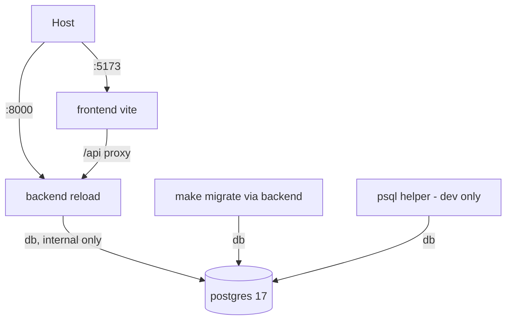

# PLAN — maxterview

**AI mock-interview coach** — practice interviews, LLM-generated questions/feedback/scoring, progress tracking. **MVP is text-only; voice is a later phase.**
Stack: FastAPI + React/TS + Postgres. Dev: Docker Compose (3-file split). Prod: git-driven `deploy/` manifests (infra external, out of scope).

> **How to use this file** — the *stable contract*: reload at session start for decisions,
> guardrails, milestone status. Transient build state lives in session memory.
>
> **Change policy:** edit only when a decision, milestone, or guardrail changes. `Last updated: 2026-08-08`

## 1. Decisions (D1–D11) — read first

| # | Decision | Rationale |
|---|---|---|
| D1 | `python:3.13-slim` in containers only; host Python irrelevant | Reproducible env; 3.13 mature (EOL 2029-10); 3.14 stable — valid upgrade path |
| D2 | Clerk fallback (`CLERK_ENABLED=false`) only in `development`/`test`; else refuse to boot | No silent unauthenticated prod; tests boot without Clerk |
| D3 | Migrations via `make migrate` = `alembic upgrade head` in the backend container; idempotent | No startup races; prod handled by external infra |
| D4 | Domain owned by Clerk `sub`; every query scoped | Auth is load-bearing |
| D5 | `DATABASE_URL` built only in compose / prod Secret; never in `.env` | Single source of truth |
| D6 | **uv** + `pyproject.toml` + committed `uv.lock`; `uv sync --frozen` in CI/Dockerfile | 2026 standard; universal lockfile |
| D7 | LLM = OpenAI-compatible client via env (`LLM_BASE_URL`/`LLM_API_KEY`/`LLM_MODEL`): **local model on dev, DeepSeek on prod**; stub for tests | One interface, no vendor lock; DeepSeek is OpenAI-compatible |
| D8 | Prod = `deploy/` Kustomize manifests + CI push to registry; infra external | Ship exactly what the controller consumes |
| D9 | Secrets via **SealedSecrets** (encrypted in git) | No plaintext secrets; no extra infra |
| D10 | Frontend React + TS + Vite + **shadcn/ui**; backend structlog + **Sentry** | User choices; TS matches API schemas |
| D11 | **Monolithic backend**: routes + validation + handlers inline in `app/main.py` (mirrors `diagram_website`'s `server.ts`); single `app/db.py` for the engine/session | MVP simplicity; no premature package layering; matches an existing, proven codebase shape |

## 2. Stack

| Layer | Choice |
|---|---|
| API | FastAPI ≥0.141 + Uvicorn, Pydantic v2 |
| DB | PostgreSQL 17, SQLAlchemy 2 async + asyncpg (0.31: Python 3.9–3.14 ✓, Postgres ≤18 ✓) |
| Migrations | Alembic (sync `psycopg` via URL rewrite `+asyncpg`→`+psycopg`) |
| AI (core) | `app/services/llm/`: OpenAI-compatible client driven by env (`LLM_BASE_URL`/`LLM_API_KEY`/`LLM_MODEL`) — local model on dev, DeepSeek on prod; async **SSE** streaming; Pydantic structured output; test stub |
| Auth | Clerk — manual JWT/JWKS verification (PyJWT + cryptography); no official Python SDK exists |
| Config | plain env reads via `os.getenv` in `app/main.py`/`app/db.py`; fail fast on missing required; `.env` (git-ignored) / `.env.example` (committed) |
| Observability | structlog (JSON in prod) + Sentry |
| Frontend | React + TS + Vite + shadcn/ui; nginx reverse proxy, same-origin `/api` |
| Packaging | uv + `pyproject.toml` + `uv.lock`; dev deps in `[dependency-groups]` |
| Quality | ruff, pytest (unit + integration vs Postgres), pre-commit, Trivy (CI+CD), Biome (TS) |
| Runtime | Docker Compose v2 (dev), `python:3.13-slim` |

> Frontend toolchain pins: React 19.2 · Vite 8.1 · TypeScript 7.0 · Tailwind 4.3 · Biome 2.4 · node:lts-alpine · nginx-unprivileged 1.31-alpine. Scaffold with shadcn/ui's official Vite setup (`tailwindcss` + `@tailwindcss/vite`, `@/*` alias).

## 3. Topology

**3a. Dev** — `compose.yml` (shared) + `compose.dev.yml` overlay

**3b. Prod** — git-driven `deploy/` manifests = Kustomize (backend, frontend, postgres, SealedSecrets, ingress); CI pushes images to a registry. Infra external (D8), no build here.

## 4. Config & auth contract (guardrails)

- **`DATABASE_URL`**: composed only from `POSTGRES_*` in compose overlays / prod Secret (D5). Never in `.env`.
- **Config**: plain `os.getenv` reads resolved at module top in `app/main.py` / `app/db.py`; fail fast (raise) on missing required values (e.g. `DATABASE_URL`). `.env.example` = canonical shape. (D11)
- **Clerk**: same-origin `__session` cookie (primary, Clerk-managed); `Authorization: Bearer` also accepted for API clients/tests. Backend verifies JWT against Clerk JWKS (`RS256`, validate `iss`/`aud`/`exp`) → `ClerkUser` (`sub`, email, name, session_id) via `get_current_user` (D2/D4).
- **LLM**: `LLM_BASE_URL`/`LLM_API_KEY`/`LLM_MODEL` via env (keys in secrets in prod); dev = local model (no key), prod = DeepSeek. Prompts typed + versioned in the service layer, never inlined in routers (D7).

## 5. Data model

- `interviews` — `id` (UUID pk), `owner_id` (Clerk `sub`, FK+index), `role/topic`, `status` (pending\|in_progress\|completed), timestamps
- `messages` — `id`, `interview_id` (FK, cascade), `role` (user\|assistant\|system), `content`, `created_at`
- `feedback` — `id`, `interview_id` (FK), per-dimension scores (Pydantic/JSONB), overall verdict, actionable tips, `created_at`
- All queries scoped to `owner_id`. Migrations: hand-written initial; later via `make revision m="..."`.

## 6. Workflows

| Command | Action |
|---|---|
| `make up` / `make dev` | Start dev stack (postgres + backend + frontend); hot reload on `dev` |
| `make prod` | Build + start prod-style images |
| `make migrate` / `make revision m=...` | Apply / autogenerate migrations |
| `make lint` / `make format` | ruff in container |
| `make test` | pytest unit + integration (vs Postgres service) |
| `make psql` / `make shell` / `make logs` / `make down` / `make clean` | ops |

- CI/CD: `.github/workflows/` — CI lints + tests (with Trivy), CD builds → scans → smoke-tests → pushes images. Details in the YAML.

## 7. Security checklist

- [ ] No credentials in code/compose; `.env` git-ignored; prod secrets via SealedSecrets only
- [ ] Postgres on internal network (dev) / dedicated namespace + restricted Service (prod)
- [ ] Non-root users in images; no curl/bash injection surfaces
- [ ] Deps pinned: `uv.lock` committed; `uv sync --frozen` in CI and Dockerfile
- [ ] Clerk fallback refuses to boot outside `development`
- [ ] CORS locked to frontend origin (prod same-origin via nginx; dev via Vite proxy)
- [ ] LLM: no raw prompt-injection surface via API; provider keys in secrets; rate/usage limits on streaming
- [ ] Health/readiness endpoints don't leak internals

## 8. Milestones

| # | Milestone | Deliverables | Status |
|---|---|---|---|
| 1 | Root infra | `compose.yml`/`compose.dev.yml`/`compose.prod.yml`, Makefile, `scripts/port-claimer.sh`, env/gitignore, CI/CD workflows, frontend Dockerfile/nginx/biome/trivy (imported, no lgtm) | [x] |
| 2 | Backend core | Monolith: `app/main.py` (FastAPI app + lifespan + `/health` + graceful shutdown), `app/db.py` (engine/session + `get_db`), `pyproject.toml`/`uv.lock`, backend Dockerfile (dev/prod targets, uv recipe) | [ ] |
| 3 | Backend API | Routes added inline in `app/main.py` (interviews CRUD, SSE stub) — no `api/v1/` tree (D11); models stay in `app/main.py` | [ ] |
| 4 | LLM layer | `app/llm.py` (OpenAI-compatible client, prompt registry, structured output, stub) — single module (D11) | [ ] |
| 5 | Migrations + tests | Alembic env + initial migration (interviews/messages/feedback) + migrate service; pytest suite | [ ] |
| 6 | Frontend | React+TS+Vite+shadcn/ui, `package.json`, API wiring | [ ] |
| 7 | CI + deploy manifests | Workflows verified; `deploy/` Kustomize (backend/frontend/postgres, SealedSecrets, ingress); README | [ ] |
| 8 | Verify | `compose config`, build, up, `make test`/`make lint`, `kustomize build deploy/` | [ ] |

> **Next action:** milestone 2 — monolith `app/main.py` + `app/db.py` + `pyproject.toml`/`uv.lock` + backend Dockerfile (uv recipe). Awaiting GO. Start here. 
> **Status:** M1 done; no blockers; the plan has been planned/verified extensively — begin building at the next opportunity.
