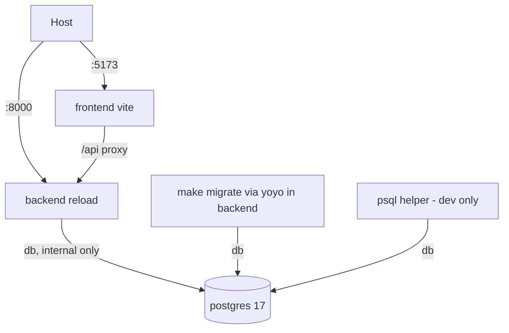

# PLAN — maxterview

**AI mock-interview coach** — practice interviews, LLM-generated questions/feedback/scoring, progress tracking. **MVP is text-only; voice is a later phase.**
Stack: FastAPI + React/TS + Postgres. Dev: Docker Compose (3-file split).

> **How to use this file** — the *stable contract*: reload at session start for decisions,
> guardrails, milestone status. Transient build state lives in session memory.
> **Product requirements** live in `PRD.md`; **application flow + diagrams** in `APPFLOW.md`.
>
> **Change policy:** edit only when a decision, milestone, or guardrail changes. `Last updated: 2026-08-11`

## 1. Decisions (D1–D9) — read first

| # | Decision | Rationale |
|---|---|---|
| D1 | `python:3.13-slim` in containers only; host Python irrelevant | Reproducible env; 3.13 mature (EOL 2029-10); 3.14 stable — valid upgrade path |
| D2 | Clerk fallback (`CLERK_ENABLED=false`) only in `development`/`test`; else refuse to boot | No silent unauthenticated prod; tests boot without Clerk |
| D3 | Migrations via `make migrate` = `yoyo apply` (backend container, `yoyo-migrations` CLI); `.sql` files **whose entire body is the "up" step**, with a **separate `<name>.rollback.sql`** for rollback; tracks applied state in `_yoyo_migration` | **Correction (2026-08-16):** yoyo does **NOT** use in-file `-- migrate:up/-- migrate:down` markers — it treats the whole `.sql` as up and reads rollback from a separate `.rollback.sql`. An in-file `-- migrate:down` block gets executed as UP (created-and-dropped the tables). Lightweight Python analogue of node-pg-migrate (diagram_website reference); per-version tracking |
| D4 | Domain owned by Clerk `sub`; every query scoped | Auth is load-bearing |
| D5 | `DATABASE_URL` built only in compose / prod Secret; never in `.env` | Single source of truth |
| D6 | **uv** + `pyproject.toml` + committed `uv.lock`; `uv sync --frozen` in CI/Dockerfile | 2026 standard; universal lockfile |
| D7 | LLM = OpenAI-compatible client via env (`LLM_BASE_URL`/`LLM_API_KEY`/`LLM_MODEL`): **local model on dev, DeepSeek on prod**; stub for tests | One interface, no vendor lock; DeepSeek is OpenAI-compatible |
| D8 | Frontend React + TS + Vite + **shadcn/ui** + **react-router** (SPA, deep-linkable `/interviews/:id`); backend structlog | User choices; TS matches API schemas |
| D9 | **Monolithic backend**: routes + validation + handlers inline in `app/main.py` (mirrors `diagram_website`'s `server.ts`); **raw SQL via asyncpg**, single `app/db.py` (lazy pool) | MVP simplicity; no ORM, no premature layering; matches an existing, proven codebase shape |
| D10 | **Monetization: simple two-tier free/premium.** `ClerkUser.tier` claim (`free`/`premium`), entitlement = JWT claim + active `premium` row in `subscriptions` (`resolve_tier`). **Quotas (turn-based, no token metering — decision 2026-08-23):** **free = 1 interview/day (counts CREATED, atomic conditional INSERT, UTC-midnight reset) + 8 chat turns/interview; premium = unlimited interviews + 100 turns** ($9.99/mo ref, monthly, MULTI-CURRENCY). **Features IDENTICAL across tiers** — only quota differs. **Consumption ≠ JWT:** counted server-side from `interviews` (daily) + `interviews.chat_turns` (per-interview), both `owner_id`-scoped (D4). **Atomicity (races):** daily cap via conditional `INSERT ... WHERE NOT EXISTS ... HAVING count(*) >= limit`; chat-turn via check + `bump_chat_turn`. **Provider = raw Stripe** (not Clerk-billing; ownership/learning/scale). **Caching:** counters DB-backed; `tier` in JWT + JWKS cached; Redis deferred. No trial; overage = **lockout** (block new only, never touch existing); **cancel = access till end of paid period, no refunds**; **3-day refund window**; **chargeback → immediate free downgrade + Stripe dispute**; **failed renewal = immediate downgrade, no grace**; **upgrade forces JWT refresh**; tax: **Stripe calculates, we remit**; usage-status `GET /usage`. **Shipped (backend quotas + raw Stripe) 2026-08-24; deferred: Stripe keys/payment testing, frontend UX, live Clerk.** Full plan in `MONETIZATION.md`. | `tier` is a one-field, non-breaking addition now; retrofitting gating later is costly. Simplest model that covers an AI-coach SaaS. Turn-based metering avoids LLM token accounting |

## 2. Stack

| Layer | Choice |
|---|---|
| API | FastAPI ≥0.141 + Uvicorn, Pydantic v2 |
| DB | PostgreSQL 17, **asyncpg direct + raw SQL** (no SQLAlchemy; mirrors diagram_website's pg pool) |
| Migrations | **yoyo-migrations** (Python node-pg-migrate analogue): `.sql` files in `backend/migrations/` — **whole file = "up" step, separate `<name>.rollback.sql` for rollback** (NOT in-file `-- migrate:up/down`, see D3); `make migrate` / `make rollback` / `make new-migration`; tracks applied state. **Driver note:** yoyo's Postgres backend uses `psycopg2-binary` (see `yoyo.backends.core.postgresql` `driver_module="psycopg2"`) — this is why it's a dep; the app runtime itself uses `asyncpg` only |
| AI (core) | `app/llm.py` (D9): OpenAI-compatible client driven by env (`LLM_BASE_URL`/`LLM_API_KEY`/`LLM_MODEL`) — local model on dev, DeepSeek on prod; async **SSE** streaming; Pydantic structured output; test stub |
| Auth | Clerk — manual JWT/JWKS verification (PyJWT + cryptography); no official Python SDK exists |
| Config | plain env reads via `os.getenv` in `app/main.py`/`app/db.py`; fail fast on missing required; `.env` (git-ignored) / `.env.example` (committed) |
| Observability | structlog (JSON in prod) + Grafana Cloud (Loki/Prometheus/Grafana). No Sentry (decision, M13) |
| Frontend | React + TS + Vite + Tailwind 4 + shadcn/ui + react-router (installed, M8 done). nginx reverse proxy, same-origin `/api` |
| Packaging | uv + `pyproject.toml` + `uv.lock`; dev deps in `[dependency-groups]` |
| Quality | ruff, pytest (unit + integration vs Postgres), Biome (TS). Trivy noted for later (deps scan) |
| Runtime | Docker Compose v2 (dev), `python:3.13-slim` |

> Frontend toolchain (installed for M8): React 19.2 · Vite 8.1 · TypeScript 7.0 · Tailwind 4.3 · **react-router v7** · Biome 2.4 · node:lts-alpine · nginx-unprivileged 1.31-alpine. Tailwind 4 via `@tailwindcss/vite` + shadcn/ui (`@/*` alias, `components.json`).

## 3. Topology

**3a. Dev** — `compose.yml` (shared) + `compose.dev.yml` overlay

## 4. Config & auth contract (guardrails)

- **`DATABASE_URL`**: composed only from `POSTGRES_*` in compose overlays / prod Secret (D5). Never in `.env`.
- **Config**: plain `os.getenv` reads resolved at module top in `app/main.py` / `app/db.py`; fail fast (raise) on missing required values (e.g. `DATABASE_URL`). `.env.example` = canonical shape. (D9)
- **DB access**: raw SQL via the asyncpg pool helpers in `app/db.py` (`fetch`/`fetchrow`/`execute`). Handlers call these directly — no session-per-request, no ORM (D9).
- **Clerk**: same-origin `__session` cookie (primary, Clerk-managed); `Authorization: Bearer` also accepted for API clients/tests. Backend verifies JWT against Clerk JWKS. **Implemented (2026-08-11, `app/auth.py`):** RS256-pinned (reject `none`/HS256), JWKS key selected by `kid`, RSA pubkey reconstructed from JWKS `n`/`e`, validate `iss` (=`CLERK_DOMAIN`) + `exp`; `aud` validated **ONLY if `CLERK_AUDIENCE` set** (empty default in `.env.example` → aud-gate off). JWKS fetched via httpx and cached (TTL ~1h; `kid`-miss re-fetch once). Any failure → `HTTPException(401)`, fixed message, no token details leaked. → `ClerkUser` (`sub`, email, name, `sid`→session_id) via `get_current_user` (D2/D4). Frontend: `@clerk/react`, `<ClerkProvider publishableKey>` + sign-in/user buttons wired.
- **LLM**: `LLM_BASE_URL`/`LLM_API_KEY`/`LLM_MODEL` via env (keys in secrets in prod); dev = local model (no key), prod = DeepSeek. Prompts typed + versioned in the service layer, never inlined in routers (D7).

## 5. Data model

- `interviews` — `id` (UUID pk), `owner_id` (Clerk `sub`, FK+index), `role/topic`, `status` (pending\|in_progress\|completed), timestamps
- `messages` — `id`, `interview_id` (FK, cascade), `role` (user\|assistant\|system), `content`, `created_at`
- `feedback` — `id`, `interview_id` (FK), per-dimension scores (Pydantic/JSONB), overall verdict, actionable tips, `created_at`
- All queries scoped to `owner_id`. Migrations: yoyo-migrations (`.sql` with up/down markers) via `make migrate`; apply/rollback/new-migration targets.

## 6. Workflows

| Command | Action |
|---|---|
| `make up` / `make dev` | Start dev stack (postgres + backend + frontend); hot reload on `dev` |
| `make prod` | Build + start prod-style images |
| `make migrate` / `make rollback` / `make new-migration name=...` | Apply / roll back / create yoyo migrations |
| `make lint` / `make format` | ruff in container |
| `make test` | pytest unit + integration (vs Postgres service) |

- CI/CD: `.github/workflows/` — CI lints + tests. **Deploy target: k3s + GitOps** (Argo CD App-of-Apps in the separate `notseekeru/gitops` repo, Terraform-installed). CD pipeline scaffolded but disabled — re-enable (GHCR build/push + `kustomize edit set image` bump) once `apps/maxterview` manifests exist. See README **Deployment**. Trivy noted for later.

## 7. Security checklist

- [x] No credentials in code/compose; `.env` git-ignored (verified via `git check-ignore`)
- [x] Postgres on internal network (dev — `compose.yml` `internal: true`); prod must keep this guarantee
- [x] Non-root users in images (`appuser` backend, `node` frontend); no curl/bash injection surfaces
- [x] Deps pinned: committed `uv.lock` + `package-lock.json`; `uv sync --frozen` / `npm ci` in CI + Dockerfile
- [x] Clerk fallback refuses to boot outside `development`/`test` (D2 guard in `main.py`)
- [ ] **CORS:** no `CORSMiddleware` in the backend — currently relies on same-origin nginx/Vite proxy. Add an explicit origin allow-list only if the API is ever opened cross-origin
- [ ] **LLM prompt-injection:** no explicit sanitization; relies on the system prompt. Streaming rate-limited at the ingress (gitops `limit-rps`); free-tier quota (interview/turn caps) now enforced by M10
- [x] Health/readiness endpoints don't leak internals (`/health` = `{status:ok}` only)
- [ ] (Later) Trivy deps scan — noted, not MVP; observability (structlog/Grafana) tracked in M13/`OBSERVABILITY.md`

> **M11 (security, docs)** — full threat model and accepted-risks summary in `SECURITY.md`.
## 8. Milestones

| # | Milestone | Deliverables | Status |
|---|---|---|---|
| 1 | Root infra | `compose.yml`/`compose.dev.yml`/`compose.prod.yml`, Makefile, `scripts/port-claimer.sh`, env/gitignore, CI/CD workflows, frontend Dockerfile/nginx/biome | [x] |
| 2 | Backend core | Monolith: `app/main.py` (FastAPI app + lifespan + `/health` + graceful shutdown + D2 guard), `app/db.py` (engine/session), `pyproject.toml`/`uv.lock`, backend Dockerfile (dev/prod targets, uv recipe) | [x] |
| 3 | Data foundations | `backend/migrations/*.sql` (yoyo format: interviews/messages/feedback), asyncpg pool + query helpers in `app/db.py`; `make migrate` via yoyo | [x] |
| 4 | Auth seam | `get_current_user` dependency: dev-fallback user when `CLERK_ENABLED=false`; real Clerk JWKS verification (`verify_jwt`/`_fetch_jwks` in `app/auth.py`) — RS256, kid, iss/aud/exp, JWKS cache. Frontend `@clerk/react` + `<ClerkProvider>` wired. Every handler depends on it (D4) | [x] |
| 5 | Backend API | Routes inline in `app/main.py` (D9): interviews CRUD + messages + feedback + SSE stub, all scoped to `owner_id` via `get_current_user`. **Lifecycle (2026-08-19):** `POST /interviews/{id}/start` (pending→in_progress) and `/complete` (in_progress→completed); `POST /interviews/{id}/feedback` (write, UPSERT on unique interview_id); chat rejected unless `in_progress` (409). **`POST /interviews/{id}/messages` REMOVED (2026-08-19)** — the `chat/stream` endpoint owns the user turn. **`GET /interviews` includes avg `score` + `verdict` via LEFT JOIN feedback (US5, avoids N+1).** **JSONB round-trips natively via asyncpg codec in `db.py`.** **Tier-ready:** `tier` on every handler; billing quota enforced via `app/billing.py` (M10) | [x] |
| 6 | LLM layer | `app/llm.py` (OpenAI-compatible client, prompt registry, structured output, test stub); wire real streaming into the SSE endpoint. **Done (2026-08-19):** `llm.py` with `stream_chat` (delta SSE) + `generate_feedback` (structured `FeedbackSummary`), **STUB_MODE** when no `LLM_BASE_URL` (deterministic, tests run model-free); `chat_stream` persists user+assistant turns; `complete` auto-generates+writes feedback (decision: inside complete). Prompts versioned in `llm.py` (D7/PLAN§4). **Hardened 2026-08-23:** `max_tokens` caps + `LLM_DISABLE_THINKING` (env) bound runaway local Qwen; smoke scripts `scripts/llm-smoke*.sh` + `make test-llm` | [x] |
| 7 | Tests | pytest suite: `/health`, CRUD, owner-scoping (integration vs Postgres); CI goes green. **Done (2026-08-19):** integration tests self-migrate (session fixture runs `yoyo apply` via `DATABASE_URL`, no separate CI migration step); tests force LLM STUB_MODE and run against the real DB without `M5_TEST_DATABASE_URL`. Backend + frontend CI steps verified locally (ruff/pytest/biome/typecheck/build all green) | [x] |
| 8 | Frontend | React+TS+Vite + Tailwind 4 + shadcn/ui + @/* alias. **App built (2026-08-23):** create-interview form, history list, SSE chat screen (create→start→chat/stream→complete→feedback), native fetch SSE, **react-router** URLs (`/`, `/interviews/:id`), Clerk dev/no-auth fallback. Verified green (typecheck/build/biome) and in-browser. Caveat: local llama.cpp auto-feedback may be empty (documented in `.env.example`); DeepSeek validated | [x] |
| 9 | Verify + README | **Done (2026-08-23):** `compose config` (dev+prod) valid; backend ruff check/format + pytest 19 passed; frontend biome/typecheck/build green; `README.md` added | [x] |
| 10 | Billing/monetization | **Backend shipped (2026-08-24):** quotas (`app/billing.py` — atomic daily cap, chat-turn cap, `resolve_tier`, `GET /usage`) + **raw Stripe** (`app/payments.py` — checkout/portal/webhook, signature-verified, idempotent upsert) + `0002_billing` migration. 28 tests pass. **Deferred:** Stripe keys/CLI/payment testing, frontend upsell UX + usage badge, live Clerk billing. Turn-based quotas, no token metering — `MONETIZATION.md`. | [~] |
| 11 | Security hardening | **Docs-first (2026-08-23):** verified security checklist (§7), threat model + accepted risks + rate-limiting/abuse-prevention plan + penetration-test plan in `SECURITY.md`. Later (code): app-level rate limiter (slowapi/limits), CORS allow-list, LLM prompt-injection guardrails, dependency audit (uv/npm + Trivy) | [~] |
| 12 | Frontend polish | Landing page, dashboard/home with interview stats + score charts, empty states, loading skeletons, mobile responsiveness (react-router SPA routes: `/`, `/app`, `/interviews/:id`) | [~] |
| 13 | Observability | **Docs-first (2026-08-23):** `OBSERVABILITY.md` — structlog JSON logging (foundation, prod-JSON/dev-human) + **Grafana Cloud** (Loki ingests JSON logs; **pure OTLP** for metrics/traces via OpenTelemetry SDK → Alloy, no `/metrics` scrape; Grafana dashboards/alerts). **Decision: no Sentry** (overlaps with Loki error logs for MVP). No code yet | [~] |
| 14 | RAG (retrieval-augmented interviewing) | **Future enhancement (not MVP), noted 2026-08-23.** Current LLM layer is plain chat-completion (no vector store). Add embeddings + vector retrieval (pgvector in the existing Postgres, or a vector DB) + ingestion, retrieving role/question-bank content into the interviewer/feedback prompts. Enables the PRD's out-of-scope 'custom question banks'. Depends on acquiring a question-bank knowledge base. | [ ] |
| 15 | Live voice interview (TTS + STT + webcam illusion) | **Future enhancement (not MVP) — PRD 'voice / real-time video' out-of-scope-later. Added 2026-08-24.** Make the interview feel live: **TTS** (text-to-speech) speaks the AI interviewer's questions; **STT** (speech-to-text) transcribes the candidate's spoken answers into the text chat; optional **webcam feed** for a live/video-call illusion (self-view, not analyzed). Multimodal SDK (e.g. OpenAI Realtime / Deepgram STT + ElevenLabs/Piper TTS). Backend streams audio alongside the existing SSE text; chat transcript stays the source of truth. | [ ] |

> **Next action:** M1–M9 done (MVP) + **M10 backend shipped (quotas + raw Stripe, 2026-08-24)** + M11/M13 docs-first done. Remaining: **M10 frontend upsell UX + Stripe keys/payment testing**, **M12 (frontend polish)**, and the **M11/M13 code** passes. Deploy: k3s + GitOps — re-enable CD + add `apps/maxterview` + `maxterview-secrets` + Clerk pre-ship. See README **Deployment**. 
> **Status:** M1–M9 done; M10 backend shipped (turn-based quotas + raw Stripe checkout/portal/webhook, 28 tests); M11 (security) + M13 (observability) docs-first done. M10 frontend UX + Stripe keys, M12 (frontend polish), and M11/M13 code passes pending. Deploy target k3s + GitOps (README **Deployment**); pre-ship Clerk/prod config pending. Detailed payment spec: **`MONETIZATION.md`**; product: **`PRD.md`**.
