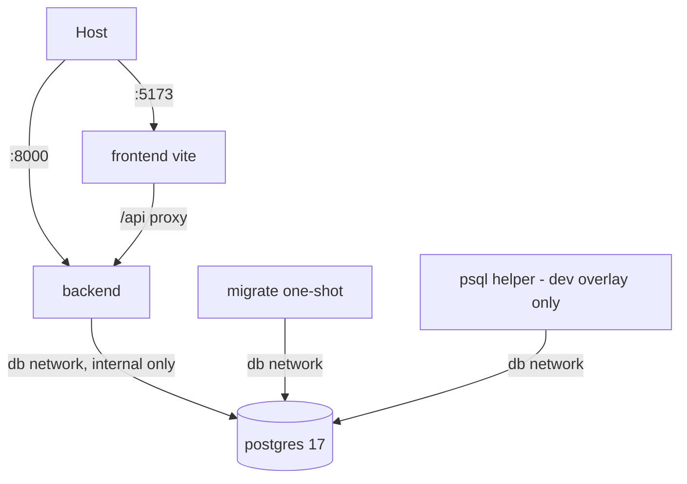
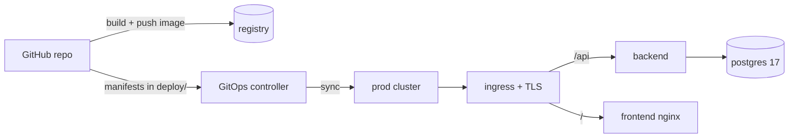

# PLAN — maxterview

**AI mock-interview coach.** Users run practice interviews (text/voice), get LLM-generated questions and feedback, and track progress. Monorepo: FastAPI backend + React/TS frontend + Postgres. Dev on Docker Compose; prod deploys from git via `deploy/` manifests (infrastructure is external and out of scope).

Status: **PLANNING** — no code drafted until user says GO.

## 1. Goals (driving principles)

User-stated philosophy: **Robustness & quality first** (security, testing, clean architecture), then isolation, declarative config, and a real DevOps loop.

| Principle | Concrete meaning |
|---|---|
| **Robust & secure** | Non-trivial logic gets tests; credentials never in code; Clerk guardrail fails closed; owner-scoped queries everywhere; provider-agnostic AI layer (no vendor lock). |
| **Isolated** | One container per service; non-root users; Postgres on an `internal` network (no host ingress); secrets only via env / SealedSecrets, never committed; Node lives in the frontend container. |
| **Declarative** | `compose.yml` + dev/prod overlays (dev) + `deploy/` manifests (prod) declare everything. Typed config via `pydantic-settings`. SQLAlchemy declarative models. Alembic for schema. Makefile = named idempotent targets. |
| **DevOps / GitOps** | GitHub Actions (lint → test → build → push image). **We ship `deploy/` manifests + CI; the production infrastructure is external and out of scope here.** One-shot migration service. Health/readiness endpoints. structlog + Sentry. |

## 2. Stack

- **API**: FastAPI (≥0.141) + Uvicorn, Pydantic v2
- **DB**: PostgreSQL 17, SQLAlchemy 2 async + asyncpg
- **Migrations**: Alembic (sync `psycopg` via URL rewrite `+asyncpg`→`+psycopg`)
- **AI (core product)**: provider-agnostic LLM layer (`app/services/llm/`) with a common interface — OpenAI-compatible / Anthropic / local (Ollama) selected by env; async streaming over **SSE** (FastAPI-native since 0.135); structured output via Pydantic; deterministic stub provider for tests
- **Auth**: Clerk — manual server-side JWT verification against Clerk JWKS (PyJWT + cryptography). **No official Python Clerk SDK exists (JS/TS only) — manual JWKS verification is the official path for Python.**
- **Config**: `pydantic-settings`, `.env` (git-ignored, dev) / `.env.example` (committed)
- **Observability**: structlog (JSON in prod) + **Sentry** (error tracking)
- **Frontend**: React + **TypeScript** + Vite + **shadcn/ui** (component library on Radix + Tailwind); nginx reverse proxy (prod), same-origin `/api`
- **Packaging**: **uv** + `pyproject.toml` + committed `uv.lock`, dev deps in `[dependency-groups]`
- **Quality**: ruff (lint+format), pytest + httpx ASGI (**unit + integration against Postgres**), pre-commit, **Trivy** scans (filesystem in CI + image in CD), **Biome** (frontend TS)
- **Dev runtime**: Docker Compose v2, `python:3.13-slim` (3.14 now stable & FastAPI-supported; 3.13 is the conservative pin)

## 3. Topology

### 3a. Dev (Docker Compose)

### 3b. Prod (deploy manifests)

> **Out of scope:** the production infrastructure and its controllers are managed externally. This plan only authors the `deploy/` manifests.

- We deliver: `deploy/` = Kustomize (base + prod overlay) → backend, frontend, postgres, SealedSecrets, ingress
- Secrets in git via **SealedSecrets** (encrypted at rest in repo); no plaintext secrets in git

## 4. Config — single source of truth

- Dev: compose dev/prod overlays build `DATABASE_URL` from `POSTGRES_USER/PASSWORD/DB`; never set in `.env`
- Prod: Secret (from SealedSecret) supplies `DATABASE_URL` etc.; **same `Settings` class, same env var contract**
- `Settings` fails fast on missing required values; `.env.example` is the canonical shape

## 5. Auth (Clerk) — guardrailed

- Client sends Clerk session token as `Authorization: Bearer` (cross-origin) or `__session` cookie (same-origin); backend verifies JWT against Clerk JWKS (official path for Python)
- `app/core/security.py`: cached JWKS fetch (`httpx`), verify `RS256`, validate `iss`/`aud`/`exp`, return `ClerkUser` (`sub`, email, name, session_id)
- `get_current_user` FastAPI dependency; **all user data queries scoped to `sub`**
- **Guardrail**: `CLERK_ENABLED=false` honored ONLY when `APP_ENV=development`; any other env → `RuntimeError` at startup

## 6. Data model — domain is an interview coach

- `interviews` — practice sessions: `id` (UUID pk), `owner_id` (Clerk `sub`), `role/topic`, `status` (pending|in_progress|completed), `created_at`, `updated_at`; FK+index on `owner_id`
- `messages` — turns in an interview: `id`, `interview_id` (FK, cascade), `role` (user|assistant|system), `content`, `created_at`
- `feedback` — per-interview assessment: `id`, `interview_id` (FK), structured scores (Pydantic/JSONB), summary, suggestions, `created_at`
- LLM interactions live in the service layer; prompts are typed and versioned, never string-splatted into routers
- Migrations: hand-written initial migration; subsequent via `make revision m="..."`

## 7. Workflows

| Command | Action |
|---|---|
| `make up` | Build + start dev stack (compose) |
| `make dev` | Compose overlay: backend `--reload`, Vite dev server, psql helper |
| `make migrate` / `make revision m=...` | Apply / autogenerate migrations |
| `make lint` / `make format` | ruff in container |
| `make test` | pytest unit + integration (against Postgres service) |
| `make ci` | lint + test (local CI approximation) |
| `make render-deploy` | Validate `deploy/` (kustomize build) — deploying itself is handled externally |

CI (`.github/workflows/ci-pipeline.yml`): matrix over backend / frontend — backend = `setup-uv` + `uv sync --frozen` + ruff + pytest (against `postgres:17` service) + Trivy fs scan; frontend = `npm ci` + Biome + tsc + build + Trivy fs scan.
CD (`.github/workflows/cd-pipeline.yml`): buildx multi-arch → registry → **Trivy image scan** → smoke-test container on health endpoint → push `git-sha` + `latest`.

## 8. Security checklist

- [ ] No credentials in code/compose; `.env` git-ignored; prod secrets via SealedSecrets only
- [ ] Postgres on internal network (dev) / dedicated namespace + restricted Service (prod)
- [ ] Non-root users in images; no curl/bash injection surfaces
- [ ] Deps pinned: `uv.lock` committed; `uv sync --frozen` in CI and Dockerfile
- [ ] Clerk fallback refuses to boot outside `development`
- [ ] CORS locked to frontend origin (prod same-origin via nginx; dev via Vite proxy)
- [ ] LLM layer: no raw prompt injection surfaces exposed via API; provider keys in secrets; rate/usage limits on streaming endpoints
- [ ] Health/readiness endpoints don't leak internals

## 9. Milestones (await GO)

| # | Milestone | Key deliverables |
|---|---|---|
| 1 | Root infra | `compose.yml` + `compose.dev.yml` + `compose.prod.yml`, `Makefile`, `scripts/port-claimer.sh`, `.gitignore`, `.env.example`, `.env`, CI/CD workflows, frontend Dockerfile/nginx/biome/trivy *(drafted; imports from diagram_website, no lgtm)* |
| 2 | Backend core | `app/core/`: `config.py`, `database.py`, `logging.py` (structlog + Sentry), `security.py` (Clerk) |
| 3 | Backend API | `main.py`, `api/v1/`: health, `interviews` CRUD, SSE stream endpoint (stub); models/schemas/services; `api/deps.py` |
| 4 | LLM layer | `app/services/llm/`: provider interface (OpenAI/Anthropic/Ollama), prompt registry, structured output, **test stub provider** |
| 5 | Migrations + tests | Alembic env + initial migration (interviews/messages/feedback) + `migrate` service; pytest unit + integration suite |
| 6 | Frontend | React + TS + Vite + shadcn/ui, nginx proxy, dev overlay; Node in container |
| 7 | CI + deploy manifests | GitHub Actions (lint→test→build→**registry**); `deploy/` Kustomize manifests (backend/frontend/postgres, SealedSecrets, ingress) for the GitOps controller; README |
| 8 | Verify | `docker compose config`, build, up, `make test`, `make lint`, `kustomize build deploy/` validation (deploy handled externally) |

## 10. Decisions log

| # | Decision | Rationale |
|---|---|---|
| D1 | `python:3.13-slim` everywhere; host Python irrelevant | Reproducible containers; 3.13 mature (EOL 2029-10); 3.14 now stable & FastAPI-supported — valid upgrade path |
| D2 | Clerk fallback only in `development` | Prevent silent unauthenticated prod |
| D3 | `migrate` one-shot service | Declarative, idempotent, no startup races |
| D4 | Domain = `interviews`/`messages`/`feedback`, all owned by Clerk `sub`, queries scoped | Auth is load-bearing; matches the product |
| D5 | `DATABASE_URL` built only in compose / prod Secret | Single source of truth, no drift |
| D6 | **uv** + `pyproject.toml` + committed `uv.lock` | 2026 standard (FastAPI docs default to uv); universal lockfile |
| D7 | LLM provider abstraction + stub for tests | Robustness: deterministic tests, no vendor lock, swap providers via env |
| D8 | Prod = git-driven `deploy/` Kustomize manifests + CI push to registry; **infrastructure is external, out of scope** | We ship exactly what the GitOps controller consumes; nothing else |
| D9 | Secrets via **SealedSecrets** | Secrets encrypted in git, no extra infra; SOPS/External-Secrets are the scale-up path |
| D10 | Frontend = React + **TS** + Vite + **shadcn/ui**; backend = structlog + **Sentry** | User choices; TS matches API schemas; Sentry for error tracking |

## 11. 2026 field verification (sources)

Checked live against current ecosystem docs (2026-08-07):

| Area | Finding | Source |
|---|---|---|
| Python | 3.14 = **bugfix** (stable) since 2025-10, EOL 2030-10; 3.13 bugfix, EOL 2029-10; 3.12 security-only. FastAPI dropped 3.9 (0.129.0) | python.org/devguide/versions; fastapi release notes |
| FastAPI | Current 0.141.x (2026-07). Python 3.14 + free-threaded 3.14t supported (0.136.0). Docs default to **uv projects**. Native **SSE** since 0.135.0 | fastapi.tiangolo.com |
| Packaging | **uv** is the standard: universal lockfile, official Docker integration | docs.astral.sh/uv |
| Ruff | 0.16.x; Python 3.14 compatible | docs.astral.sh/ruff |
| Clerk | Backend SDK is **JS/TS only**; Python path = Bearer/`__session` + manual JWT/JWKS verification | clerk.com/docs |

**Result**: architecture verified as current best practice. Updated for user answers: AI-core domain (LLM layer + SSE + interview domain model), git-driven prod (`deploy/` manifests), React **TS + shadcn/ui**, **Sentry**, unit + integration testing, robustness-first philosophy.

## 12. Imported from diagram_website

Reused infra/config from the sibling `diagram_website` repo (adapted; **no `lgtm/` observability stack**):

- `frontend/Dockerfile` (multi-stage base/dev/builder/prod, non-root node + nginx-unprivileged)
- `frontend/nginx.conf` (+ `/api` reverse proxy with SSE: `proxy_buffering off`)
- `frontend/.dockerignore`, `frontend/.trivyignore`, `frontend/biome.json`, `frontend/.env.example`
- `backend/.dockerignore` (Python-adapted), `backend/.trivyignore`
- `scripts/port-claimer.sh` (port-conflict resolver wired into `make up` / `make dev`)
- Compose 3-file split: `compose.yml` (shared) + `compose.dev.yml` + `compose.prod.yml`
- `.github/workflows/ci-pipeline.yml` + `cd-pipeline.yml` (adapted for uv/Python + Trivy + smoke tests)
- Version reference for the frontend toolchain: React 19.2, Vite 8.1, TypeScript 7.0, Tailwind 4.3
