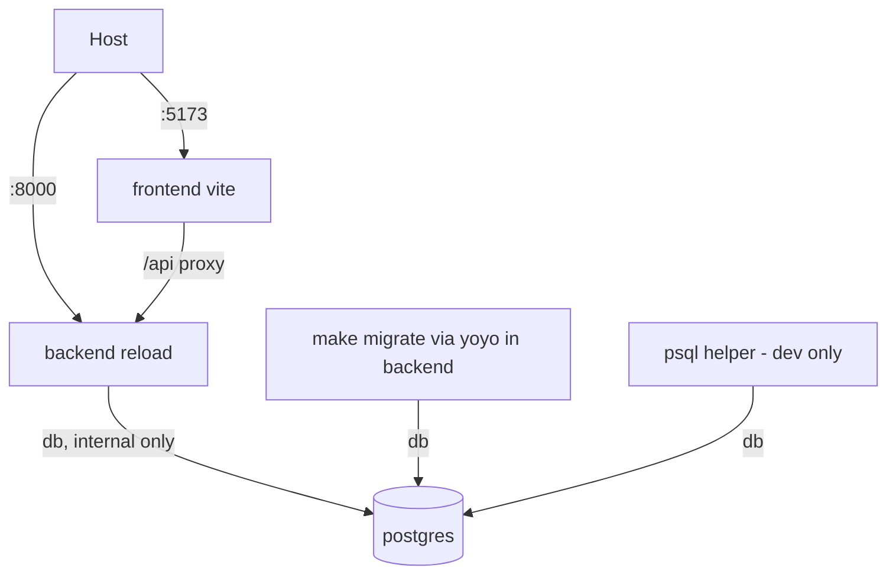
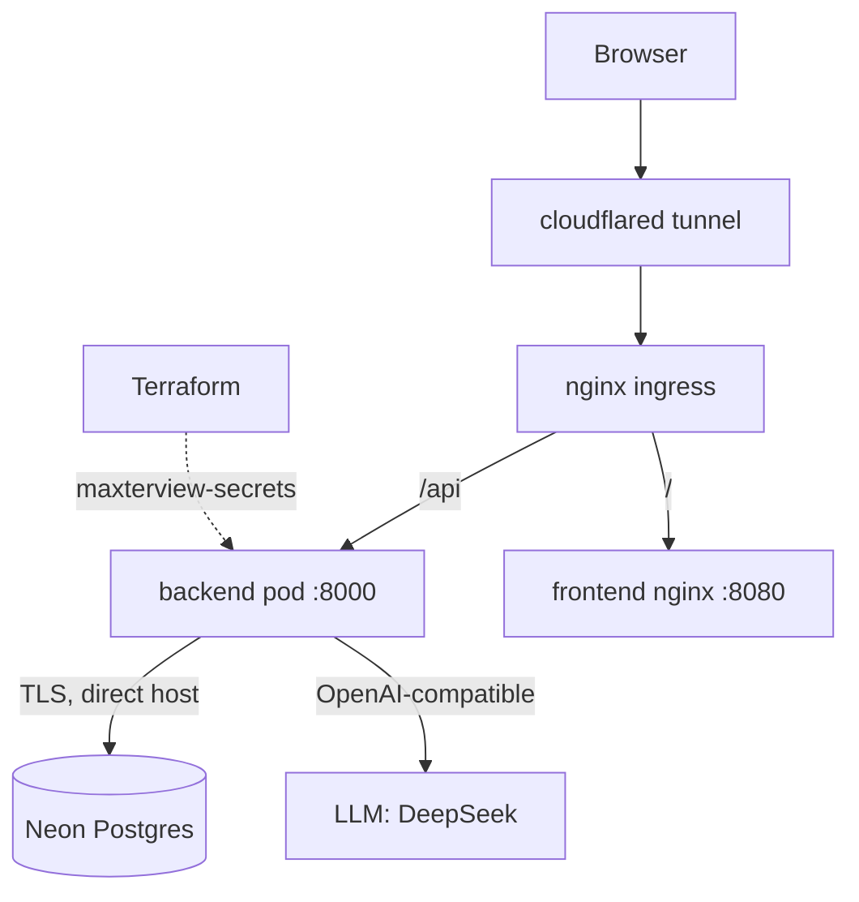

# PLAN — maxterview

 

**AI mock-interview coach** — practice interviews, LLM-generated questions/feedback/scoring, progress tracking. **MVP is text-only; voice is a later phase.**
Stack: FastAPI + React/TS + Postgres. Dev: Docker Compose (3-file split).

> **How to use this file** — the _stable contract_: reload at session start for decisions,
> guardrails, milestone status. Transient build state lives in session memory.
> **Scope:** this file = technical decisions + milestone status. The product as-built is documented in `README.md` (architecture, flow, endpoints, status); **billing spec** in `MONETIZATION.md`.
> **Docs hygiene (context = scarce):** one source of truth per topic — reference-only detail lives in its
> owning file (this file = decisions/status, MONETIZATION = billing, OBSERVABILITY = ops), never restated
> elsewhere. Decisions/status here are compact tables, not prose.
> When a milestone ships, **delete** the section that predicted it (don't add a “shipped” note beside it). Docs-first-but-not-built files are debt: prune them once their code lands.
> Before each session, `ls *.md` and drop anything whose header still claims an earlier milestone.
> Last cleanup: 2026-08-25 (APPFLOW + SECURITY folded into §7) → 2026-09-06: removed `PRD.md` (stale vs shipped billing; product framing kept in README).
>
> **Change policy:** edit only when a decision, milestone, or guardrail changes. `Last updated: 2026-09-06`

## 1. Decisions (D1–D10) — read first

| #   | Decision                                                                                                                                                                                                                                        | Rationale                                                                                                                                                                                                                                                                                                                                                                           |
| --- | ----------------------------------------------------------------------------------------------------------------------------------------------------------------------------------------------------------------------------------------------- | ----------------------------------------------------------------------------------------------------------------------------------------------------------------------------------------------------------------------------------------------------------------------------------------------------------------------------------------------------------------------------------- |
| D1  | `python:3.13-slim` in containers only; host Python irrelevant                                                                                                                                                                                   | Reproducible env; 3.13 mature (EOL 2029-10); 3.14 stable — valid upgrade path                                                                                                                                                                                                                                                                                                       |
| D2  | Clerk fallback (`CLERK_ENABLED=false`) only in `development`/`test`; else refuse to boot                                                                                                                                                        | No silent unauthenticated prod; tests boot without Clerk                                                                                                                                                                                                                                                                                                                            |
| D3  | Migrations via `make migrate` = `yoyo apply` (backend container, `yoyo-migrations` CLI); `.sql` files **whose entire body is the "up" step**, with a **separate `<name>.rollback.sql`** for rollback; tracks applied state in `_yoyo_migration` | **Correction (2026-08-16):** yoyo does **NOT** use in-file `-- migrate:up/-- migrate:down` markers — it treats the whole `.sql` as up and reads rollback from a separate `.rollback.sql`. An in-file `-- migrate:down` block gets executed as UP (created-and-dropped the tables). Lightweight Python analogue of node-pg-migrate (diagram_website reference); per-version tracking |
| D4  | Domain owned by Clerk `sub`; every query scoped                                                                                                                                                                                                 | Auth is load-bearing                                                                                                                                                                                                                                                                                                                                                                |
| D5  | `DATABASE_URL` derived, never literal: dev composes it from `POSTGRES_*`; prod injects an external secret (Neon, direct host). Never committed.                                                                                                 | Single derivation per environment; prod DB is external (Neon) so it cannot be composed                                                                                                                                                                                                                                                                                              |
| D6  | **uv** + `pyproject.toml` + committed `uv.lock`; `uv sync --frozen` in CI/Dockerfile                                                                                                                                                            | 2026 standard; universal lockfile                                                                                                                                                                                                                                                                                                                                                   |
| D7  | LLM = OpenAI-compatible client via env (`LLM_BASE_URL`/`LLM_API_KEY`/`LLM_MODEL`): **local model on dev, DeepSeek on prod**; stub for tests                                                                                                     | One interface, no vendor lock; DeepSeek is OpenAI-compatible                                                                                                                                                                                                                                                                                                                        |
| D8  | Frontend React + TS + Vite + **shadcn/ui** + **react-router** (SPA, deep-linkable `/interviews/:id`); backend structlog                                                                                                                         | User choices; TS matches API schemas                                                                                                                                                                                                                                                                                                                                                |
| D9  | **Monolithic backend**: routes + validation + handlers inline in `app/main.py` (mirrors `diagram_website`'s `server.ts`); **raw SQL via asyncpg**, single `app/db.py` (lazy pool)                                                               | MVP simplicity; no ORM, no premature layering; matches an existing, proven codebase shape                                                                                                                                                                                                                                                                                           |
| D10 | Monetization: two-tier free/premium (+ developer-only) subscriptions. Spec: `MONETIZATION.md`.                                                                                                                                                  | Retrofit gating later is costly; simplest model for an AI-coach SaaS                                                                                                                                                                                                                                                                                                                |

## 2. Stack

| Layer         | Choice                                                                                                                                                                                                                                                                                                                                                                                                                                                                                                  |
| ------------- | ------------------------------------------------------------------------------------------------------------------------------------------------------------------------------------------------------------------------------------------------------------------------------------------------------------------------------------------------------------------------------------------------------------------------------------------------------------------------------------------------------- |
| API           | FastAPI ≥0.141 + Uvicorn, Pydantic v2                                                                                                                                                                                                                                                                                                                                                                                                                                                                   |
| DB            | PostgreSQL 18, **asyncpg direct + raw SQL** (no SQLAlchemy; mirrors diagram_website's pg pool). **Dev:** container (compose). **Prod:** Neon (managed, external, direct host)                                                                                                                                                                                                                                                                                                                           |
| Migrations    | **yoyo-migrations** (Python node-pg-migrate analogue): `.sql` files in `backend/migrations/` — **whole file = "up" step, separate `<name>.rollback.sql` for rollback** (NOT in-file `-- migrate:up/down`, see D3); `make migrate` / `make rollback` / `make new-migration`; tracks applied state. **Driver note:** yoyo's Postgres backend uses `psycopg2-binary` (see `yoyo.backends.core.postgresql` `driver_module="psycopg2"`) — this is why it's a dep; the app runtime itself uses `asyncpg` only |
| AI (core)     | `app/llm.py` (D9): OpenAI-compatible client driven by env (`LLM_BASE_URL`/`LLM_API_KEY`/`LLM_MODEL`) — local model on dev, DeepSeek on prod; async **SSE** streaming; Pydantic structured output; test stub                                                                                                                                                                                                                                                                                             |
| Auth          | Clerk — manual JWT/JWKS verification (PyJWT + cryptography); no official Python SDK exists                                                                                                                                                                                                                                                                                                                                                                                                              |
| Config        | plain env reads via `os.getenv`; fail fast on missing required; **two git-ignored files**: root `.env` (infra: `APP_ENV`, `POSTGRES_*`, ports) + `backend/.env` (runtime: CLERK/LLM/quotas/STRIPE); templates `.env.example` + `backend/.env.example` (committed)                                                                                                                                                                                                                                       |
| Observability | structlog (JSON in prod) + Grafana Cloud (Loki/Prometheus/Grafana). No Sentry (decision, M13)                                                                                                                                                                                                                                                                                                                                                                                                           |
| Frontend      | React + TS + Vite + Tailwind 4 + shadcn/ui + react-router (installed, M8 done). nginx reverse proxy, same-origin `/api`                                                                                                                                                                                                                                                                                                                                                                                 |
| Packaging     | uv + `pyproject.toml` + `uv.lock`; dev deps in `[dependency-groups]`                                                                                                                                                                                                                                                                                                                                                                                                                                    |
| Quality       | ruff, pytest (unit + integration vs Postgres), Biome (TS). Trivy 0.74 fs-scan in CI + image scan in CD (`.trivyignore.yaml` dated)                                                                                                                                                                                                                                                                                                                                                                      |
| Runtime       | Docker Compose v2 (dev), `python:3.13-slim`                                                                                                                                                                                                                                                                                                                                                                                                                                                             |

> Frontend toolchain (installed for M8): React 19.2 · Vite 8.1 · TypeScript 7.0 · Tailwind 4.3 · **react-router v7** · Biome 2.4 · node:lts-alpine · nginx-unprivileged 1.31-alpine. Tailwind 4 via `@tailwindcss/vite` + shadcn/ui (`@/*` alias, `components.json`).

## 3. Topology

**3a. Dev** — `compose.yml` (shared) + `compose.dev.yml` overlay

**3b. Prod** — k3s + GitOps (mirrors the existing `diagram`/`portfolio` shape in `notseekeru/gitops`)

- **Two ingress paths, like `diagram`:** `/api` → `backend:8000` directly, `/` → `frontend:8080`. The frontend's `/api` nginx proxy is a *dev/same-origin* convenience; prod routing does not depend on it.
- **Ingress carries rate limits + CSP + CORS** (`limit-rps`, `limit-burst`, cors-allow-origin `*.seekeru.tech`) — copied from `diagram-ingress.yaml`. This is the app's only rate limiting, so it is load-bearing, not decoration.
- **Probes:** maxterview has a real `/health` route, so use **`httpGet`** (diagram must use `tcpSocket` because it lacks one).
- **No Postgres pod in prod.** The DB is Neon — no PVC, no StatefulSet, nothing to back up or upgrade in-cluster.
- **`DATABASE_URL` from `maxterview-secrets`**, a k8s Secret created by Terraform (`~/terraform`) from Infisical. Unlike `diagram-secrets`, it is **not derivable** from `var.POSTGRES_PASSWORD` (the DSN is external/Neon), so it needs its own `var.NEON_DATABASE_URL` + secret resource in `infra/k3s/main.tf`, wired into `gitops_app`'s `depends_on`. Never `kubectl`, never committed.
- **Use the DIRECT host** (`ep-<id>-<region>.aws.neon.tech`), **not** `-pooler`: the pooler is PgBouncer in transaction mode and breaks asyncpg's implicit prepared statements. `app/db.py` auto-detects a `-pooler` DSN and disables the cache, so switching later is safe — but direct needs no workaround.
- **Direct is sufficient because `replicas: 1`** (house style) → one pod holding ~10 pooled connections. The connection-storm problem this avoids only appears with many short-lived instances (serverless), which was explicitly rejected.
- **`sslmode=require`** — the DSN crosses the public internet.
- **Known tradeoff:** Pi → Neon is real network distance, and Neon free-tier compute scales to zero, so the first query after idle pays a cold-start. Measure before trusting it.
- **Credential lifecycle differs from `diagram`:** the `docs/incident-2026-09-03…` rotation runbook exists because a self-hosted role password can drift from its secret. Neon owns the role, so rotation happens in Neon + Infisical and re-apply — no `ALTER USER` step, and the mismatch failure mode does not apply.
- **GitOps adoption is a pending milestone (by design, not a defect):** images publish to GHCR, but `apps/maxterview/*`, `infra/maxterview-ingress.yaml`, `apps-of-apps/maxterview.yaml`, the root `kustomization.yaml` entry, and the CD tag-bump job are not written yet. Nothing reconciles onto the cluster until they are.

## 4. Config & auth contract (guardrails)

- **`DATABASE_URL`**: dev composes it from `POSTGRES_*` in the compose overlays (D5); prod injects it from the `maxterview-secrets` k8s Secret (Infisical via Terraform). Never in `.env`, never committed. **Prod DB is Neon (direct host, not `-pooler`)** — see §3b.
- **Config**: plain `os.getenv` reads resolved at module top in `app/main.py` / `app/db.py`; fail fast (raise) on missing required values (e.g. `DATABASE_URL`). **Two env files** (git-ignored), loaded by compose as `env_file: [.env, ./backend/.env]` (backend overrides root on collisions): root `.env` = infra only (`APP_ENV`, `POSTGRES_*`, ports); `backend/.env` = backend runtime (`CLERK`, `LLM`, quotas, `STRIPE`). Committed templates: `.env.example` (root) + `backend/.env.example`. (D9)
- **DB access**: raw SQL via the asyncpg pool helpers in `app/db.py` (`fetch`/`fetchrow`/`execute`). Handlers call these directly — no session-per-request, no ORM (D9).
- **Clerk**: same-origin `__session` cookie (primary, Clerk-managed); `Authorization: Bearer` also accepted for API clients/tests. Backend verifies JWT against Clerk JWKS. **Implemented (2026-08-11, `app/auth.py`):** RS256-pinned (reject `none`/HS256), JWKS key selected by `kid`, RSA pubkey reconstructed from JWKS `n`/`e`, validate `iss` (=`CLERK_DOMAIN`) + `exp`; `aud` validated **ONLY if `CLERK_AUDIENCE` set** (empty default in `backend/.env.example` → aud-gate off). JWKS fetched via httpx and cached (TTL ~1h; `kid`-miss re-fetch once). Any failure → `HTTPException(401)`, fixed message, no token details leaked. → `ClerkUser` (`sub`, email, name, `sid`→session_id) via `get_current_user` (D2/D4). Frontend: `@clerk/react`, `<ClerkProvider publishableKey>` + sign-in/user buttons wired.
- **LLM**: `LLM_BASE_URL`/`LLM_API_KEY`/`LLM_MODEL` via env (keys in secrets in prod); dev = local model (no key), prod = DeepSeek. Prompts typed + versioned in the service layer, never inlined in routers (D7).

## 5. Data model

- `interviews` — `id` (UUID pk), `owner_id` (Clerk `sub`, FK+index), `role/topic`, `status` (pending\|in_progress\|completed), timestamps
- `messages` — `id`, `interview_id` (FK, cascade), `role` (user\|assistant\|system), `content`, `created_at`
- `feedback` — `id`, `interview_id` (FK), per-dimension scores (Pydantic/JSONB), overall verdict, actionable tips, `created_at`
- All queries scoped to `owner_id`. Migrations: yoyo-migrations — `backend/migrations/*.sql` (whole file = up; separate `*.rollback.sql`, see D3) via `make migrate`/`rollback`.

## 6. Workflows

> All `make` targets (up/logs/shell/psql/migrate/lint/test/…): canonical list in README § **Common commands**.

- CI/CD: `.github/workflows/` — CI lints + tests and runs a **Trivy 0.74 filesystem scan** on both services (`.trivyignore.yaml`; exceptions expire 2026-12-01). **Deploy target: k3s + GitOps** (Argo CD App-of-Apps in the separate `notseekeru/gitops` repo, Terraform-installed). CD is **enabled**: on green CI to `main` it builds both prod images, Trivy-image-scans them, smoke-tests, and pushes to GHCR. It does **not** mutate the gitops repo — `apps/maxterview` manifests there are still pending before anything reconciles onto the cluster. **Renovate** (GitHub app) opens weekly grouped PRs; native Dependabot update-stream is off. See README **Deployment**.

## 7. Security checklist

- [x] No credentials in code/compose; `.env` git-ignored (verified via `git check-ignore`)
- [x] Postgres on internal network (dev — `compose.yml` `internal: true`); prod must keep this guarantee
- [x] Prod DB is external (Neon): TLS on every connection (`sslmode=require` in the DSN), no DB pod to expose in-cluster
- [x] Non-root users in images (`appuser` backend, `node` frontend); no curl/bash injection surfaces
- [x] Deps pinned: committed `uv.lock` + `package-lock.json`; `uv sync --frozen` / `npm ci` in CI + Dockerfile
- [x] Clerk fallback refuses to boot outside `development`/`test` (D2 guard in `main.py`)
- [ ] **CORS:** no `CORSMiddleware` in the backend — currently relies on same-origin nginx/Vite proxy. Add an explicit origin allow-list only if the API is ever opened cross-origin
- [ ] **LLM prompt-injection:** no explicit sanitization; relies on the system prompt. Streaming rate-limited at the ingress (gitops `limit-rps`); free-tier quota (interview/turn caps) now enforced by M10
- [x] Health/readiness endpoints don't leak internals (`/health` = `{status:ok}` only)
- [x] **Trivy deps scan wired** (CI fs-scan both services + CD image scan, `0.74.0`, `.trivyignore.yaml` dated to 2026-12-01); observability (structlog/Grafana) still tracked in M13/`OBSERVABILITY.md`

**Threat model (M11):** browser SPA → nginx/Vite `/api` proxy → FastAPI → Postgres + LLM. FastAPI is the trust boundary.

| Threat                | Mitigation                                                           | Gap                                                                                 |
| --------------------- | -------------------------------------------------------------------- | ----------------------------------------------------------------------------------- |
| Cross-tenant access   | `WHERE owner_id = sub` on every query; foreign→404 (D4)              | None                                                                                |
| Forged/replayed token | RS256-pinned, JWKS `kid`, `iss`/`exp` (`auth.py`)                    | `aud` off unless `CLERK_AUDIENCE` set                                               |
| Unauthenticated API   | `get_current_user` on every handler                                  | prod requires `CLERK_ENABLED=true`                                                  |
| Prompt injection      | system-prompt interviewer boundary; no tools given                   | no guardrail; open-ended user ans → LLM. Accept; ingress rate-limit + M10 turn caps |
| Secret exfil via LLM  | provider keys env-only, never in prompts                             | None                                                                                |
| Dependency exploit    | pinned lockfile + `npm audit` (info) + Trivy 0.74 (CI fs + CD image) | backend `.trivyignore.yaml` empty pending first CD scan findings                    |

**Accepted risks (post-MVP):** (1) LLM prompt-injection surface — non-agent model, limited blast radius, revisit if it gains tools; (2) CORS relies on same-origin proxy — add allow-list only if opened cross-origin; (3) observability not yet wired (Trivy IS live — CI fs + CD image); no GitOps deploy yet (`apps/maxterview` pending in gitops); (4) local llama.cpp has no isolation hardening (dev-only).

**Rate limiting:** ingress `limit-rps:30/limit-burst:20` (gitops) ✅; **no app-level limiter** (⚠️ add slowapi/limits M11 code); per-LLM `max_tokens` ceiling ✅; M10 turn caps ✅.

**Pre-ship checklist:** `CLERK_ENABLED=true` + real domain/JWKS + `aud`; app-level per-client rate limiter; Clerk DNS (`clerk.seekeru.tech` Pending); secrets only in k8s (`DATABASE_URL`/keys via Terraform/Infisical); Postgres on private network; enable Trivy in CD; `uv pip audit`/`npm audit` non-informational; **manual/assisted pentest** (OWASP ZAP/Burp on deployed SPA+API, scope: authz/IDOR/JWT/input/rate-limit/prompt-injection/secret leak; exit: no cross-tenant access, fixed 401/404/409/422, rate limiter trips, no secret leakage) before broad public traffic.

## 8. Milestones

Only **open / not-yet-flat milestones** are tracked below. Shipped milestones (M1–M9, M12) are pruned per the hygiene policy — full deliverable history is in `git log` and mirrored in §1/§2/§4 + README.

| #   | Milestone                                          | Deliverables                                                                                                                                                                                                                                                                                                                                                                                                                                                                                                                                                                                                                                                                  | Status |
| --- | -------------------------------------------------- | ----------------------------------------------------------------------------------------------------------------------------------------------------------------------------------------------------------------------------------------------------------------------------------------------------------------------------------------------------------------------------------------------------------------------------------------------------------------------------------------------------------------------------------------------------------------------------------------------------------------------------------------------------------------------------- | ------ |
| 10  | Billing/monetization                               | **Shipped** — shipped 2026-08-24/25 + payment-tested 2026-09-06. Spec: `MONETIZATION.md`. Residual: a live Clerk identity (`CLERK_ENABLED=true`) needed to surface `tier: premium` in `/usage`                                                                                                                                                                                                                                                                                                                                                                                                                                                                                | [x]    |
| 11  | Security hardening                                 | **Docs-first (2026-08-23):** verified security checklist + threat model + accepted risks + rate-limiting/abuse-prevention plan + penetration-test plan now folded into PLAN §7 (sole `SECURITY.md` removed 2026-08-25). **Dependency scanning shipped (2026-09-02):** CI Trivy fs-scan both services + CD image scan, `0.74.0`, per-service `.trivyignore.yaml` (dated to 2026-12-01); **Renovate** handles update PRs (Dependabot alerts on, native stream off). Remaining (code): app-level rate limiter (slowapi/limits), CORS allow-list, LLM prompt-injection guardrails                                                                                                 | [~]    |
| 13  | Observability                                      | **Docs-first (2026-08-23):** `OBSERVABILITY.md` — structlog JSON logging (foundation, prod-JSON/dev-human) + **Grafana Cloud** (Loki ingests JSON logs; **pure OTLP** for metrics/traces via OpenTelemetry SDK → Alloy, no `/metrics` scrape; Grafana dashboards/alerts). **Decision: no Sentry** (overlaps with Loki error logs for MVP). No code yet                                                                                                                                                                                                                                                                                                                        | [~]    |
| 14  | OKF (structured output)                            | **OKF proper NOT started (corrected 2026-09-11).** The `[x]` briefly recorded here marked this row's *parenthetical* deliverable, not the milestone: nothing in the repo produces or consumes an OKF bundle, and the interviewer's knowledge (role/level expectations, rubric, question intents) still lives in prompt strings. **Structured-output prerequisite shipped 2026-09-11** (`7d59c69`): feedback scoring on the separate grader→formatter surface under `response_format=json_schema` (required 4 dims, integer 1-10, 2-4 tips) + greedy decoding, downgrading to `json_object` where the provider rejects it, validated by `_valid_scores`. **Remaining (the OKF half):** author that knowledge as OKF bundles — markdown + YAML frontmatter, non-empty `type` required, `index.md`/`log.md` reserved, concept id = path minus `.md` (spec: `GoogleCloudPlatform/open-knowledge-format`, v0.2 trust signals) — and load them into the interviewer/grader prompts; this is the "gap that logically precedes" M15 RAG. Original note: **Future enhancement (not MVP). Added 2026-09-09.** Bounded: function-level, no new infra (git-authored markdown, no vector store until M15). | [ ]    |
| 15  | RAG (retrieval-augmented interviewing)             | **Future enhancement (not MVP), noted 2026-08-23.** Current LLM layer is plain chat-completion (no vector store). Add embeddings + vector retrieval (pgvector in the existing Postgres, or a vector DB) + ingestion, retrieving role/question-bank content, framed _after_ the M14 OKF/structured-output hardening. Enables the out-of-scope 'custom question banks' feature. **Start here (2026-09-11 decision): M14's OKF half defers to this milestone — author the knowledge as OKF bundles in git first (role/level expectations, rubric, question intents; markdown + YAML frontmatter, `type` required), then ingest them.** Depends on acquiring a question-bank knowledge base.                                                                                                                                                                                                                                            | [ ]    |
| 16  | Live voice interview (TTS + STT + webcam illusion) | **Future enhancement (not MVP) — out-of-scope-later. Added 2026-08-24.** Make the interview feel live: **TTS** (text-to-speech) speaks the AI interviewer's questions; **STT** (speech-to-text) transcribes the candidate's spoken answers into the text chat; optional **webcam feed** for a live/video-call illusion (self-view, not analyzed). Multimodal SDK (e.g. OpenAI Realtime / Deepgram STT + ElevenLabs/Piper TTS). Backend streams audio alongside the existing SSE text; chat transcript stays the source of truth.                                                                                                                                              |

> **Overall status:** see README **Status**. Next live-blocker: M10 residual needs a live Clerk identity; then **M11/M13 code passes**, then deploy target k3s + GitOps.
