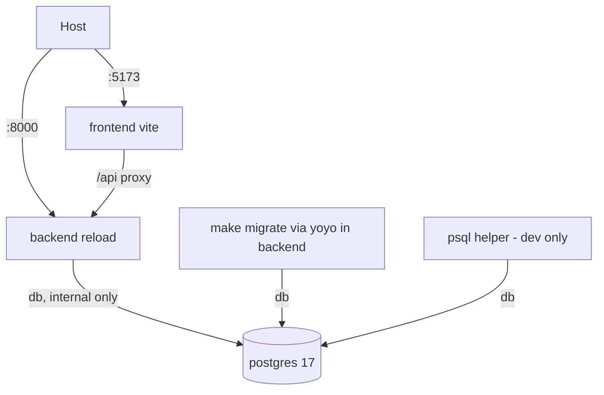

# PLAN — maxterview

**AI mock-interview coach** — practice interviews, LLM-generated questions/feedback/scoring, progress tracking. **MVP is text-only; voice is a later phase.**
Stack: FastAPI + React/TS + Postgres. Dev: Docker Compose (3-file split).

> **How to use this file** — the *stable contract*: reload at session start for decisions,
> guardrails, milestone status. Transient build state lives in session memory.
>
> **Change policy:** edit only when a decision, milestone, or guardrail changes. `Last updated: 2026-08-08`

## 1. Decisions (D1–D9) — read first

| # | Decision | Rationale |
|---|---|---|
| D1 | `python:3.13-slim` in containers only; host Python irrelevant | Reproducible env; 3.13 mature (EOL 2029-10); 3.14 stable — valid upgrade path |
| D2 | Clerk fallback (`CLERK_ENABLED=false`) only in `development`/`test`; else refuse to boot | No silent unauthenticated prod; tests boot without Clerk |
| D3 | Migrations via `make migrate` = `yoyo apply` (backend container, `yoyo-migrations` CLI); `.sql` files with `-- migrate:up/-- migrate:down`; tracks applied state in `_yoyo_migrations` table | Lightweight Python analogue of node-pg-migrate (diagram_website reference); no SQLAlchemy/Alembic; per-version tracking |
| D4 | Domain owned by Clerk `sub`; every query scoped | Auth is load-bearing |
| D5 | `DATABASE_URL` built only in compose / prod Secret; never in `.env` | Single source of truth |
| D6 | **uv** + `pyproject.toml` + committed `uv.lock`; `uv sync --frozen` in CI/Dockerfile | 2026 standard; universal lockfile |
| D7 | LLM = OpenAI-compatible client via env (`LLM_BASE_URL`/`LLM_API_KEY`/`LLM_MODEL`): **local model on dev, DeepSeek on prod**; stub for tests | One interface, no vendor lock; DeepSeek is OpenAI-compatible |
| D8 | Frontend React + TS + Vite + **shadcn/ui**; backend structlog | User choices; TS matches API schemas |
| D9 | **Monolithic backend**: routes + validation + handlers inline in `app/main.py` (mirrors `diagram_website`'s `server.ts`); **raw SQL via asyncpg**, single `app/db.py` (lazy pool) | MVP simplicity; no ORM, no premature layering; matches an existing, proven codebase shape |

## 2. Stack

| Layer | Choice |
|---|---|
| API | FastAPI ≥0.141 + Uvicorn, Pydantic v2 |
| DB | PostgreSQL 17, **asyncpg direct + raw SQL** (no SQLAlchemy; mirrors diagram_website's pg pool) |
| Migrations | **yoyo-migrations** (Python node-pg-migrate analogue): `.sql` files in `backend/migrations/` with `-- migrate:up` / `-- migrate:down`; `make migrate` / `make rollback` / `make new-migration`; tracks applied state |
| AI (core) | `app/llm.py` (D9): OpenAI-compatible client driven by env (`LLM_BASE_URL`/`LLM_API_KEY`/`LLM_MODEL`) — local model on dev, DeepSeek on prod; async **SSE** streaming; Pydantic structured output; test stub |
| Auth | Clerk — manual JWT/JWKS verification (PyJWT + cryptography); no official Python SDK exists |
| Config | plain env reads via `os.getenv` in `app/main.py`/`app/db.py`; fail fast on missing required; `.env` (git-ignored) / `.env.example` (committed) |
| Observability | structlog (JSON in prod). Sentry noted for later |
| Frontend | React + TS + Vite + shadcn/ui; nginx reverse proxy, same-origin `/api` |
| Packaging | uv + `pyproject.toml` + `uv.lock`; dev deps in `[dependency-groups]` |
| Quality | ruff, pytest (unit + integration vs Postgres), Biome (TS). Trivy noted for later (deps scan) |
| Runtime | Docker Compose v2 (dev), `python:3.13-slim` |

> Frontend toolchain pins: React 19.2 · Vite 8.1 · TypeScript 7.0 · Tailwind 4.3 · Biome 2.4 · node:lts-alpine · nginx-unprivileged 1.31-alpine. Scaffold with shadcn/ui's official Vite setup (`tailwindcss` + `@tailwindcss/vite`, `@/*` alias).

## 3. Topology

**3a. Dev** — `compose.yml` (shared) + `compose.dev.yml` overlay

## 4. Config & auth contract (guardrails)

- **`DATABASE_URL`**: composed only from `POSTGRES_*` in compose overlays / prod Secret (D5). Never in `.env`.
- **Config**: plain `os.getenv` reads resolved at module top in `app/main.py` / `app/db.py`; fail fast (raise) on missing required values (e.g. `DATABASE_URL`). `.env.example` = canonical shape. (D9)
- **DB access**: raw SQL via the asyncpg pool helpers in `app/db.py` (`fetch`/`fetchrow`/`execute`). Handlers call these directly — no session-per-request, no ORM (D9).
- **Clerk**: same-origin `__session` cookie (primary, Clerk-managed); `Authorization: Bearer` also accepted for API clients/tests. Backend verifies JWT against Clerk JWKS. **Implemented (2026-08-11, `app/auth.py`):** RS256-pinned (reject `none`/HS256), JWKS key selected by `kid`, RSA pubkey reconstructed from JWKS `n`/`e`, validate `iss` (=`CLERK_DOMAIN`) + `exp`; `aud` validated **ONLY if `CLERK_AUDIENCE` set** (empty default in `.env.example` → aud-gate off). JWKS fetched via httpx and cached (TTL ~1h; `kid`-miss re-fetch once). Any failure → `HTTPException(401)`, fixed message, no token details leaked. → `ClerkUser` (`sub`, email, name, `sid`→session_id) via `get_current_user` (D2/D4). Frontend: `@clerk/react`, `<ClerkProvider publishableKey>` + sign-in/user buttons wired.
- **LLM**: `LLM_BASE_URL`/`LLM_API_KEY`/`LLM_MODEL` via env (keys in secrets in prod); dev = local model (no key), prod = DeepSeek. Prompts typed + versioned in the service layer, never inlined in routers (D7).

## 5. Data model

- `interviews` — `id` (UUID pk), `owner_id` (Clerk `sub`, FK+index), `role/topic`, `status` (pending\|in_progress\|completed), timestamps
- `messages` — `id`, `interview_id` (FK, cascade), `role` (user\|assistant\|system), `content`, `created_at`
- `feedback` — `id`, `interview_id` (FK), per-dimension scores (Pydantic/JSONB), overall verdict, actionable tips, `created_at`
- All queries scoped to `owner_id`. Migrations: yoyo-migrations (`.sql` with up/down markers) via `make migrate`; apply/rollback/new-migration targets.

## 6. Workflows

| Command | Action |
|---|---|
| `make up` / `make dev` | Start dev stack (postgres + backend + frontend); hot reload on `dev` |
| `make prod` | Build + start prod-style images |
| `make migrate` / `make rollback` / `make new-migration name=...` | Apply / roll back / create yoyo migrations |
| `make lint` / `make format` | ruff in container |
| `make test` | pytest unit + integration (vs Postgres service) |

- CI/CD: `.github/workflows/` — CI lints + tests. CD pipeline commented out for now; re-enable when needed. Trivy noted for later.

## 7. Security checklist

- [ ] No credentials in code/compose; `.env` git-ignored
- [ ] Postgres on internal network (dev)
- [ ] Non-root users in images; no curl/bash injection surfaces
- [ ] Deps pinned: `uv.lock` committed; `uv sync --frozen` in CI and Dockerfile
- [ ] Clerk fallback refuses to boot outside `development`
- [ ] CORS locked to frontend origin (prod same-origin via nginx; dev via Vite proxy)
- [ ] LLM: no raw prompt-injection surface via API; provider keys in secrets; rate/usage limits on streaming
- [ ] Health/readiness endpoints don't leak internals
- [ ] (Later) Trivy deps scan + Sentry — noted, not MVP

## 8. Milestones

| # | Milestone | Deliverables | Status |
|---|---|---|---|
| 1 | Root infra | `compose.yml`/`compose.dev.yml`/`compose.prod.yml`, Makefile, `scripts/port-claimer.sh`, env/gitignore, CI/CD workflows, frontend Dockerfile/nginx/biome | [x] |
| 2 | Backend core | Monolith: `app/main.py` (FastAPI app + lifespan + `/health` + graceful shutdown + D2 guard), `app/db.py` (engine/session), `pyproject.toml`/`uv.lock`, backend Dockerfile (dev/prod targets, uv recipe) | [x] |
| 3 | Data foundations | `backend/migrations/*.sql` (yoyo format: interviews/messages/feedback), asyncpg pool + query helpers in `app/db.py`; `make migrate` via yoyo | [x] |
| 4 | Auth seam | `get_current_user` dependency: dev-fallback user when `CLERK_ENABLED=false`; real Clerk JWKS verification (`verify_jwt`/`_fetch_jwks` in `app/auth.py`) — RS256, kid, iss/aud/exp, JWKS cache. Frontend `@clerk/react` + `<ClerkProvider>` wired. Every handler depends on it (D4) | [x] |
| 5 | Backend API | Routes inline in `app/main.py` (D9): interviews CRUD + messages + SSE stub, all scoped to `owner_id` via `get_current_user` | [ ] |
| 6 | LLM layer | `app/llm.py` (OpenAI-compatible client, prompt registry, structured output, test stub); wire real streaming into the SSE endpoint | [ ] |
| 7 | Tests | pytest suite: `/health`, CRUD, owner-scoping (integration vs Postgres); CI goes green | [ ] |
| 8 | Frontend | React+TS+Vite scaffold with **minimal stub** (tsconfig, vite.config, index.html, `src/App.tsx`) to keep CI green; full shadcn/ui app + API wiring later | [~] |
| 9 | Verify + README | `compose config`, build, up, `make test`/`make lint`; README | [ ] |

> **Next action:** milestone 4 done — including **real** JWT/JWKS verification implemented and tested (9 tests green, self-generated keys; proven against live Clerk pending a real sign-in token). `CLERK_ENABLED` still `false` (dev fallback); flip to `true` with real Clerk env pre-ship. Next: milestone 5 — backend API (CRUD + messages + SSE stub, all owner-scoped via `get_current_user`). Start here. 
> **Status:** M1–M4 done (M4 real auth complete, 2026-08-11). Foundations-first sequence locked.
